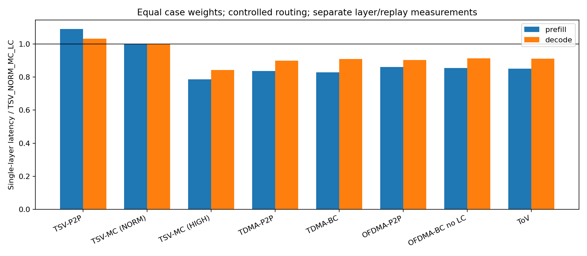
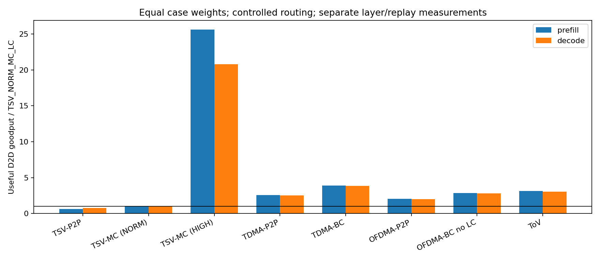
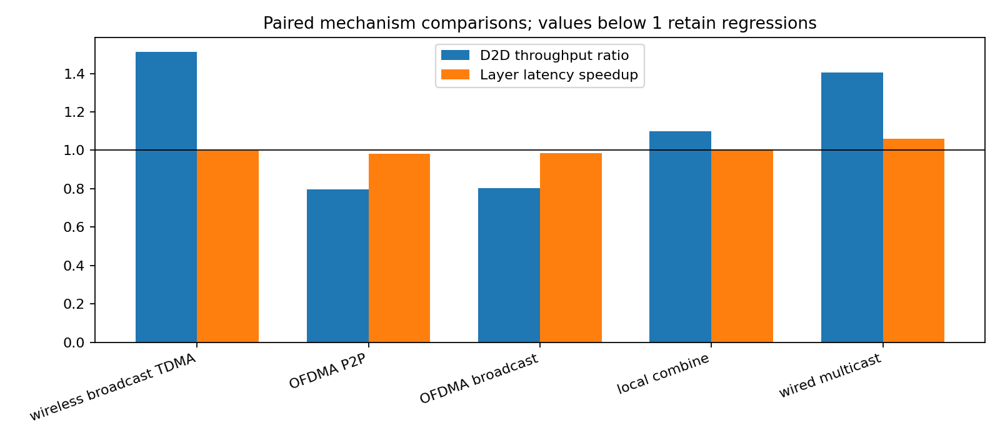
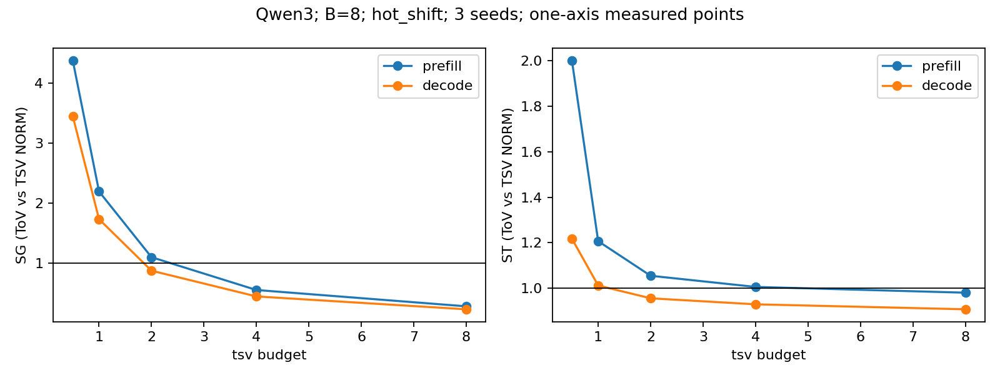
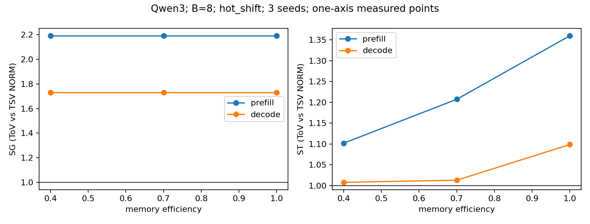
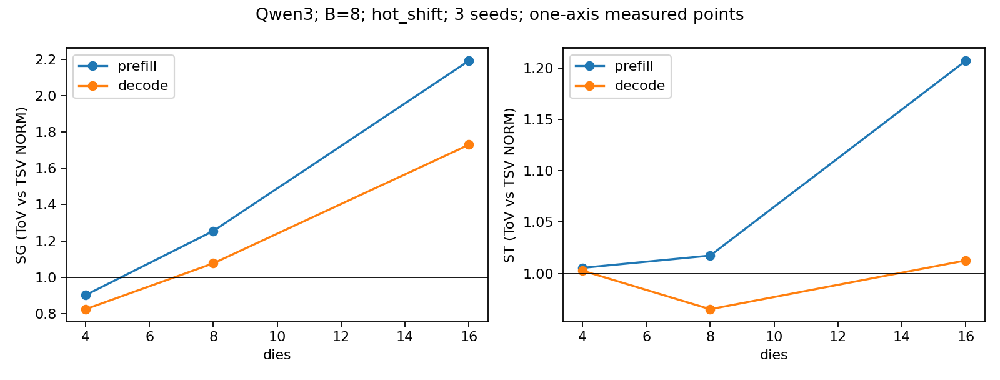
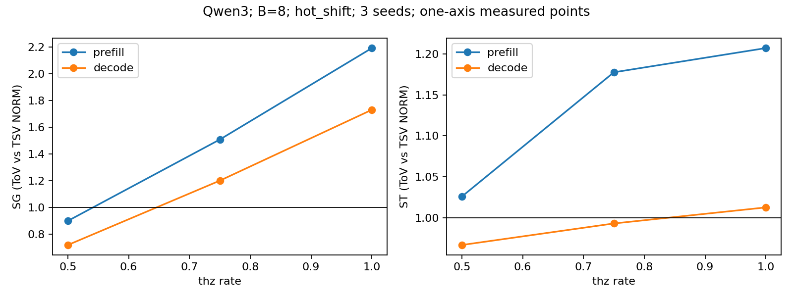
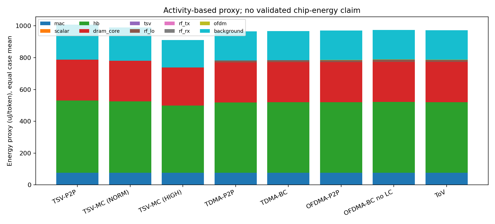

# ToV-MoE 完整仿真报告

## 1. 仿真目标

按上传的 ToV_MoE_MINIMAL_SIM_SPEC.md，分别衡量有效 D2D 交付吞吐率和完整单 MoE 层闭环延迟，并检查广播、OFDMA、Local Combine 的独立作用及适用边界。NORM 采用相同聚合 raw-link 预算；HIGH 提供强有线情景。

## 2. 仿真简述

默认 16 个 V-Die、每 Die 4 GiB DRAM、1 GHz、FP8 E4M3FN/FP32 累加。每节点峰值 8.192 TOPS，总峰值 131.072 TOPS；HB 峰值 819.2 GB/s。kernel 与 DMA 带宽分别为 501.76 / 102.4 GB/s。此版本完全采用新规范的频率和路由定义。

使用三个官方 config 与 AutoTokenizer。数据集原始 360 行，过滤去重后 360 行；每种子 32 条相同请求，3 个种子；不加载模型权重。响应只决定 teacher-forced Decode 长度。路由为冻结 PCG64 生成的 uniform/hot_shift 受控 Top-k，不能解释为真实 Router 的实测行为。

| model | d | h | E | k | shared |
| --- | --- | --- | --- | --- | --- |
| gpt_oss_20b | 2880 | 2880 | 32 | 4 | 0 |
| qwen3_30b_a3b | 2048 | 768 | 128 | 8 | 0 |
| ernie_21b_a3b | 2560 | 1536 | 64 | 6 | 2 |

## 3. 仿真参数表与含义

所有可配置参数和含义均列于下表及 simulation_parameters.csv；config_resolved.json 记录派生量、官方结构、软件版本和规范 SHA-256。MB/GB 使用十进制，MiB/GiB 使用二进制。

| parameter | value | meaning |
| --- | --- | --- |
| schema_version | "tov-minimal-1.0" | 配置格式版本；用于拒绝不兼容配置 |
| hardware.dies | 16 | V-Die 数量；Base 另计一个端点 |
| hardware.dram_bytes_per_die | 4294967296 | 每 Die DRAM 容量，byte |
| hardware.banks_per_die | 16 | 每 Die 内存 bank 数 |
| hardware.pe_per_die | 16 | 每 Die NMP PE 数量 |
| hardware.mac_rows | 16 | 每 PE MAC 阵列行数 |
| hardware.mac_cols | 16 | 每 PE MAC 阵列列数 |
| hardware.clock_hz | 1000000000 | NMP 主频，Hz；本规范恢复为 1 GHz |
| hardware.hb_pins_per_bank | 1024 | 每 bank 的 HB pin 数 |
| hardware.hb_pin_gbps | 0.4 | 每 HB pin 的速率，Gb/s |
| hardware.compute_efficiency | 0.7 | 矩阵计算效率，乘峰值 OP/s |
| hardware.kernel_memory_efficiency | 0.7 | kernel 分区内部有效访存比例 |
| hardware.dma_bandwidth_fraction | 0.125 | HB 峰值固定分配给网络 DMA 的比例 |
| hardware.vector_elements_per_cycle | 32 | 逐元素操作吞吐，元素/周期 |
| hardware.kernel_startup_ns | 2 | 每算子任务启动时间，ns |
| hardware.staging_bytes_per_die | 8388608 | 每 Die 有限 DRAM staging 空间，byte |
| hardware.base_staging_bytes | 8388608 | Base staging 空间，byte |
| hardware.base_dma_GBps | 1024 | Base 串行 DMA 带宽，十进制 GB/s |
| precision.weight | "fp8_e4m3fn" | 权重存储格式 |
| precision.activation | "fp8_e4m3fn" | 线上向量格式 |
| precision.accumulation | "fp32" | 内部累加格式 |
| precision.weight_block | 128 | 权重量化二维 block 边长 |
| precision.activation_block | 128 | 向量量化 block 元素数 |
| precision.scale_bytes | 4 | 每个量化 scale 的字节数 |
| execution.owner_window | 4 | 每 owner 最多同时在途 token 数 |
| execution.expert_batch_max | 8 | 每专家微批 token 上限 |
| execution.batch_wait_ns | 200 | 专家队列最老输入的聚批等待上限，ns |
| packet.header_bytes | 32 | 每包固定包头 byte，含目的 mask |
| packet.crc_bytes | 4 | 每包 CRC byte |
| packet.expert_entry_bytes | 8 | 每个 expert ID/gate 目录项 byte |
| radio.groups_per_die | 2 | 独立频谱域数；Base-facing 与 peer-facing |
| radio.unicast_gbps | 132 | 每域共享的单播原始总速率，Gb/s |
| radio.broadcast_gbps | 80 | 每域共享的多目的广播原始总速率，Gb/s |
| radio.carrier_GHz | 153.8 | 载波频率记录，GHz；不用于倍乘数字带宽 |
| radio.frame_ns | 100 | 全局对齐调度帧长，ns |
| radio.guard_ns | 5 | 帧保护/TDMA 帧内换向保护时间，ns |
| radio.controller_ns | 5 | 控制仲裁时间代理，ns |
| radio.report_bytes | 8 | 每源 HOL flow 报告 byte |
| radio.grant_base_bytes | 8 | 固定 grant byte |
| radio.grant_bytes_per_ru | 4 | 每 RU grant byte |
| radio.rus | 16 | 每域资源单元总数 |
| radio.fft_bins | 256 | FFT bin 数 |
| radio.data_bins | 224 | 携带数据的 bin 数 |
| radio.cp_bins | 16 | 循环前缀长度 |
| radio.endpoint_pipeline_ns | 5 | 每包每端点流水时间，ns |
| radio.ofdm_extra_endpoint_ns | 10 | OFDM 每端点附加流水时间，ns |
| radio.rate_scale | 1.0 | 单播和广播速率共同缩放系数 |
| tsv.normalized_total_gbps | 264 | NORM 所有端口聚合原始设计预算，Gb/s；不是 TSV 技术上限 |
| tsv.high_bw_total_GBps | 896 | HIGH 强有线聚合带宽情景，GB/s |
| tsv.payload_efficiency | 0.9 | TSV payload 服务效率 |
| tsv.turnaround_ns | 5 | 半双工端口换向时间，ns |
| tsv.base_route_ns | 5 | Base 完整收包后的转发处理时间，ns |
| tsv.endpoint_pipeline_ns | 5 | 每跳每端点流水时间，ns |
| workload.dataset | "MohamedRashad/ChatGPT-prompts" | 公开文本数据集 ID |
| workload.split | "train" | 数据集划分 |
| workload.requests_per_seed | 32 | 每种子无放回请求数 |
| workload.seeds | [11, 23, 37] | PCG64 抽样与路由种子 |
| workload.batch_sizes | [1, 8] | 每 cohort 并发请求数 B |
| workload.phases | ["prefill", "decode"] | Prefill 与 teacher-forced 单层 Decode |
| workload.prefill_token_cap | 256 | 每请求最大输入 token 数 |
| workload.decode_step_cap | 32 | 每请求最大 Decode 轮数 |
| workload.routing_profiles | ["uniform", "hot_shift"] | 受控合成路由分布 |
| workload.zipf_alpha | 1.2 | hot_shift 排名权重指数 |
| workload.prefill_hot_epoch_tokens | 128 | Prefill 每个热集周期的逻辑 token 数 |
| workload.decode_hot_epoch_steps | 4 | Decode 每个热集周期的轮数 |
| models[0].id | "gpt_oss_20b" | 模型内部标识 |
| models[0].repo | "openai/gpt-oss-20b" | 官方 Hugging Face 仓库 |
| models[0].layer_index | 1 | 所模拟 MoE 层索引 |
| models[0].d | 2880 | 隐藏向量维度 |
| models[0].h | 2880 | 每 routed/shared 分支中间维度 |
| models[0].E | 32 | routed 专家总数 |
| models[0].k | 4 | 每 token routed Top-k 数 |
| models[0].shared | 0 | 每 token 额外共享分支数 |
| models[0].expert_bias | true | 专家矩阵是否含 bias |
| models[0].router_bias | true | Router 是否含 bias |
| models[0].activation_rule | "gpt_oss_swiglu" | 模型对应的门控非线性规则 |
| models[1].id | "qwen3_30b_a3b" | 模型内部标识 |
| models[1].repo | "Qwen/Qwen3-30B-A3B" | 官方 Hugging Face 仓库 |
| models[1].layer_index | 1 | 所模拟 MoE 层索引 |
| models[1].d | 2048 | 隐藏向量维度 |
| models[1].h | 768 | 每 routed/shared 分支中间维度 |
| models[1].E | 128 | routed 专家总数 |
| models[1].k | 8 | 每 token routed Top-k 数 |
| models[1].shared | 0 | 每 token 额外共享分支数 |
| models[1].expert_bias | false | 专家矩阵是否含 bias |
| models[1].router_bias | false | Router 是否含 bias |
| models[1].activation_rule | "silu_gate" | 模型对应的门控非线性规则 |
| models[2].id | "ernie_21b_a3b" | 模型内部标识 |
| models[2].repo | "baidu/ERNIE-4.5-21B-A3B-PT" | 官方 Hugging Face 仓库 |
| models[2].layer_index | 1 | 所模拟 MoE 层索引 |
| models[2].d | 2560 | 隐藏向量维度 |
| models[2].h | 1536 | 每 routed/shared 分支中间维度 |
| models[2].E | 64 | routed 专家总数 |
| models[2].k | 6 | 每 token routed Top-k 数 |
| models[2].shared | 2 | 每 token 额外共享分支数 |
| models[2].expert_bias | false | 专家矩阵是否含 bias |
| models[2].router_bias | false | Router 是否含 bias |
| models[2].activation_rule | "silu_gate" | 模型对应的门控非线性规则 |
| methods | ["TSV_NORM_P2P_LC", "TSV_NORM_MC_LC", "TSV_HIGH_MC_LC", "THZ_TDMA_P2P_LC", "THZ_TDMA_BCAST_LC", "THZ_OFDMA_P2P_LC", "THZ_OFDMA_BCAST_NO_LC", "TOV_OFDMA_BCAST_LC"] | 全部八个互连/数据流对照 |
| primary_baseline | "TSV_NORM_MC_LC" | 主要对照方法 |
| primary_proposal | "TOV_OFDMA_BCAST_LC" | 完整 ToV 方案 |
| energy.mac_pJ | 0.982 | 每有效 MAC 的代理能耗，pJ |
| energy.hb_pJ_per_bit | 0.88 | HB 接口每访问 bit 代理能耗，pJ |
| energy.dram_core_pJ_per_bit | 0.5 | DRAM core 每访问 bit 代理能耗，pJ |
| energy.scalar_pJ_per_op | 1.0 | 每标量操作代理能耗，pJ |
| energy.tsv_pJ_per_bit_hop | 0.2 | TSV 每实际 bit-hop 代理能耗，pJ |
| energy.rf_lo_mW_per_node | 32 | 每节点两域共享 LO 功率，mW |
| energy.rf_tx_mW | 6.35 | 活动域 TX 电路功率，mW |
| energy.rf_rx_mW | 5.6 | 活动域 RX 电路功率，mW |
| energy.ofdm_W_per_active_endpoint | 0.1 | 每活动端点/域 OFDM/EQ 基带功率代理，W |
| energy.background_W_per_die | 0.5 | 每 Die 背景功率代理，W |
| energy.base_W | 0.1 | Base 背景功率代理，W |
| experiment.bootstrap_samples | 2000 | 分层配对 bootstrap 重采样次数 |
| experiment.bootstrap_seed | 2026 | bootstrap 固定 PCG64 种子 |
| sensitivity.model | "qwen3_30b_a3b" | 敏感性分析模型 ID |
| sensitivity.B | 8 | 敏感性分析并发请求数 |
| sensitivity.routing_profile | "hot_shift" | 敏感性分析路由分布 |
| sensitivity.tsv_budget_multipliers | [0.5, 1, 2, 4, 8] | TSV NORM 聚合预算倍数，单轴变化 |
| sensitivity.thz_rate_scales | [0.5, 0.75, 1] | THz 速率缩放点；控制时间同步重算 |
| sensitivity.die_counts | [4, 8, 16] | 配对节点数敏感性点 |
| sensitivity.memory_efficiencies | [0.4, 0.7, 1.0] | kernel 访存效率敏感性点；DMA 分区不变 |
| sensitivity.ofdm_endpoint_power_W | [0, 0.1, 0.4] | 基带功率代理重计价点，W；不重跑时序 |

参数来源与 P/A/D 分类沿用上传规范。以下是规范中的硬件与设计来源表；P 为论文锚点，A 为架构代理，D 为设计选择，并非本次流片测量。

| 参数 | 数值 | 含义/来源 |
|---|---|---|
| hardware.dies | 16 | V-Die 模块/通信节点数；D |
| hardware.dram_bytes_per_die | 4294967296 | 每模块 4 GiB；按 [P2] 4 GB/channel 的容量标称作二进制建模；P/A |
| hardware.banks_per_die / pe_per_die | 16 / 16 | bank 与 PE 数；[P2] Table III；P |
| hardware.mac_rows / mac_cols / clock_hz | 16 / 16 / 1000000000 | 每 PE MAC 阵列与主频；[P2]；P |
| 派生峰值算力 | 8.192 TOPS/Die | 2×16×16×16×1 GHz；16 Die 共 131.072 TOPS |
| hardware.hb_pins_per_bank / hb_pin_gbps | 1024 / 0.4 | 模块内部 HB 接口；[P2]；P |
| 派生 HB 峰值 | 819.2 GB/s/Die | 16×1024×0.4 Gb/s÷8，不能写成 51.2 GB/s/Die |
| hardware.compute_efficiency / kernel_memory_efficiency | 0.7 / 0.7 | 算力利用率与 kernel 分配带宽内的有效访存比例；A |
| hardware.dma_bandwidth_fraction | 0.125 | HB 峰值的 1/8 固定留给网络 staging DMA；A |
| 派生 kernel / DMA 带宽 | 501.76 / 102.4 GB/s | kernel=819.2×(1−0.125)×0.7；两者同时使用不超过物理峰值 |
| hardware.vector_elements_per_cycle | 32 | SFE/逐元素操作代理吞吐；A |
| hardware.kernel_startup_ns | 2 | 每个算子任务启动开销；A |
| hardware.staging_bytes_per_die / base_staging_bytes | 8388608 / 8388608 | 每节点 DRAM staging 上限 8 MiB；不是增加 8 MiB SRAM；D |
| hardware.base_dma_GBps | 1024 | Base staging DMA 吞吐代理；不作为有线共享瓶颈；A |
| execution.owner_window | 4 | 每 owner 同时在途的 token 上限；D |
| execution.expert_batch_max / batch_wait_ns | 8 / 200 | 每专家微批上限、最长聚批等待；D |
| precision.weight / activation / accumulation | FP8 E4M3FN / FP8 E4M3FN / FP32 | 权重、线上向量及内部累加精度；D/A |
| precision.weight_block / activation_block / scale_bytes | 128 / 128 / 4 | 权重 128×128 block，向量每 128 元素一个 FP32 scale；D |
| packet.header_bytes / crc_bytes / expert_entry_bytes | 32 / 4 / 8 | 包头、CRC、expert ID+gate 等目录项；D |
| radio.groups_per_die | 2 | Base-facing 与 peer-facing 两个独立频谱域；D |
| radio.unicast_gbps / broadcast_gbps | 132 / 80 | 每域总速率锚点；[P1] 实验段/Fig.25–28；P |
| radio.carrier_GHz | 153.8 | 载波记录，不参与把数字率乘倍的计算；[P1]；P |
| radio.frame_ns / guard_ns / controller_ns | 100 / 5 / 5 | 帧长、保护间隔、仲裁处理代理；D/A |
| radio.report_bytes / grant_base_bytes / grant_bytes_per_ru | 8 / 8 / 4 | 每节点一个 HOL flow 报告、grant 固定项和每 RU grant 项；D |
| radio.rus / fft_bins / data_bins / cp_bins | 16 / 256 / 224 / 16 | RU 数；有效 OFDM 比例 η=224/(256+16)；D |
| radio.endpoint_pipeline_ns / ofdm_extra_endpoint_ns | 5 / 10 | 每次发送端或接收端固定流水延迟；OFDM 每端额外延迟；A |
| radio.rate_scale | 1.0 | 对单播、广播锚点同时缩放；A |
| tsv.normalized_total_gbps | 264 | 等于 THz 两个频谱域的单播速率和；**归一化设计预算，不是 TSV 实测值**；D |
| tsv.high_bw_total_GBps | 896 | [P3] HBM3 实验聚合带宽，用作强有线带宽情景；不是完整 HBM 系统复现；P/A |
| tsv.payload_efficiency / turnaround_ns / base_route_ns | 0.9 / 5 / 5 | 有线有效率、端口换向、Base 存储转发处理；A |
| tsv.endpoint_pipeline_ns | 5 | 每跳发送端、接收端各 5 ns；A |
| workload.dataset / split | MohamedRashad/ChatGPT-prompts / train | 数据集；[D1] |
| workload.requests_per_seed / seeds | 32 / [11,23,37] | 每种子无放回取 32 条请求；D |
| workload.batch_sizes | [1,8] | Prefill 与 Decode 各使用两种并发请求数；D |
| workload.prefill_token_cap / decode_step_cap | 256 / 32 | 每请求输入截断上限、teacher-forced Decode 最大轮数；D |
| workload.routing_profiles | [uniform,hot_shift] | 两种受控路由；不是模型实测路由；D |
| workload.zipf_alpha | 1.2 | hot_shift 的专家排名权重指数；D |
| workload.prefill_hot_epoch_tokens / decode_hot_epoch_steps | 128 / 4 | 按逻辑 token 序号/Decode 轮次改变热专家集；D |
| energy.mac_pJ | 0.982 | 从 [P2] PE MAC 峰值功耗与吞吐推导；FP8 移植为 A |
| energy.hb_pJ_per_bit | 0.88 | [P2] HB I/O 能耗口径；不包含完整 DRAM core；P/A |
| energy.dram_core_pJ_per_bit / scalar_pJ_per_op | 0.5 / 1.0 | DRAM core 动态、逐元素操作的代理；A |
| energy.tsv_pJ_per_bit_hop | 0.2 | TSV 每实际跳、每 bit 的设计代理；不是 [P3] 测量值；A |
| energy.rf_lo_mW_per_node / rf_tx_mW / rf_rx_mW | 32 / 6.35 / 5.6 | [P1] 电路功耗拆分；LO 每节点共用，TX/RX 按活动组；P |
| energy.ofdm_W_per_active_endpoint | 0.1 | 新增 OFDM/EQ 基带功耗代理；必须做 0/0.1/0.4 W 重算；A |
| energy.background_W_per_die / base_W | 0.5 / 0.1 | DRAM/逻辑背景及 Base 控制功耗代理；A |
| experiment.bootstrap_samples / bootstrap_seed | 2000 / 2026 | 几何均值配对 bootstrap 及随机种子；D |
| sensitivity.tsv_budget_multipliers | [0.5,1,2,4,8] | 归一化 TSV 总带宽倍数；其余不变；D |
| sensitivity.thz_rate_scales | [0.5,0.75,1] | 检查理想 THz 锚点下调的影响；D |
| sensitivity.die_counts | [4,8,16] | 相同 N 下配对比较；较小规模不冒充 16 节点物理验证；D |
| sensitivity.memory_efficiencies | [0.4,0.7,1.0] | kernel 访存效率敏感性；保留 DMA 分区；D |

## 4. 仿真流程

冻结小型输入及官方仓库 revision → 按固定请求次序生成 36 个路由 trace → 单位、容量、因果与数学验证 → 576 个完整层配置 + 576 个通信回放配置 → 单轴敏感性 → 能耗账本重计价 → 2000 次分层配对 bootstrap → 输出 CSV、图表与本文档。

事件日历采用整数 ps 的 Python heapq。完成/释放先于新工作和仲裁；一个 Die 只有一个 NMP 引擎，Combine 优先，其次 Router，最后已满足条件的最老专家批。专家批不超过 8，等待上限 200 ns；每 owner 最多 4 个在途 token。所有 32/B 个 cohort 均执行，Decode 每轮的全部输出到达 Base 后才开始下一轮。

Base 输入 → owner Router → 远端 Dispatch → 专家微批 → Local Combine/逐专家 Return → owner 最终 Combine → Base 输出。通信回放移除 Base 输入/输出及算子时间，保留相同路由、DMA、窗口、包长、调度和完整返回依赖。

实现中明确的细节：Prefill 在固定请求序列间按 token 位置轮转 admission，再进入每 owner FIFO；hot_shift 使用正方向循环移位排名。Local Combine 将同 Die 的 FP32 输出求和并量化融合为一个向量任务；最终 Combine 直接读取本地 FP32 和远端 FP8 向量，在寄存器中反量化并做 FP32 求和，避免不存在的 DRAM 中间副本。端点 DMA 处理完整包，单独计费。全部输入、FP32 输出、待发和接收包均计入 staging。

TSV 使用 N 条可并行半双工星形端口，完整包经 Base 存储转发；MC 在源端发送一份，Base 出口逐份收费。无线每域共用一份频谱，控制只见当前 HOL flow；TDMA 帧内工作保持，OFDMA 固定本帧 RU 并计入 224/272 效率。每服务段整数 ps 向上取整不提高服务速率，实际包 bit 数完整计费。

能耗包括 MAC、scalar、HB、DRAM core、互连及背景代理。TX/RX 与 OFDM 按端点/域活动区间并集计算；OFDM 活动包括控制和端点流水的保守代理。两个域共享节点 LO，保护时间仅计 LO。TDMA 在线均衡未知成本未标定。

## 5. 仿真结果

所有 1524 条计划记录完成：主层 576、主回放 576、敏感性 336、能耗重计价 36。其中 1296 个独立时序配置实际运行，192 个相同/不受该轴影响的敏感性点复用，并保留 reference。运行了 140,520,868 个日历事件，验证 1,210,600 个实际仿真 token 完整贡献集合。计时实验 wall-clock 为 317.2 秒，4 个进程；这是主机执行开销，不是芯片延迟。

下表吞吐与延迟倍数分别来自独立回放和完整层实验。ST>1 表示 ToV 延迟较低，SG>1 表示有效交付吞吐较高；95% CI 为配对 bootstrap 区间。HIGH 结果紧邻 NORM，不能将 NORM 带宽写为 TSV 技术上限。

| phase | baseline | SG_95CI | ST_95CI | latency_reduction_percent |
| --- | --- | --- | --- | --- |
| prefill | TSV_NORM_MC_LC | 3.1422 [2.9268, 3.3530] | 1.1759 [1.1632, 1.1861] | 14.9591 |
| decode | TSV_NORM_MC_LC | 3.0600 [3.0540, 3.0670] | 1.0990 [1.0962, 1.1015] | 9.0063 |
| all | TSV_NORM_MC_LC | 3.1008 [2.9918, 3.2029] | 1.1368 [1.1306, 1.1419] | 12.033 |
| prefill | TSV_HIGH_MC_LC | 0.1226 [0.1142, 0.1308] | 0.9251 [0.9196, 0.9299] | -8.09409 |
| decode | TSV_HIGH_MC_LC | 0.1470 [0.1467, 0.1473] | 0.9245 [0.9222, 0.9262] | -8.16884 |
| all | TSV_HIGH_MC_LC | 0.1343 [0.1295, 0.1387] | 0.9248 [0.9220, 0.9276] | -8.13146 |

## 6. 结果整理与对照

每个 model×phase×B×profile 先用三个种子的原始观测合并；Prefill 用 cohort makespan 均值，Decode 用所有有效轮次延迟均值，吞吐为总 useful bytes/总回放时间。再对 24 个 case 比值等权取几何均值。bootstrap 先抽种子，再抽整 cohort；同 phase/B 的模型与方法共用索引，Decode 的全部轮次保持成簇。仅三个种子，区间只覆盖此受控工作负载的不确定性。

| mechanism | baseline | proposal | SG | ST | SE_proxy |
| --- | --- | --- | --- | --- | --- |
| wireless_broadcast_TDMA | THZ_TDMA_P2P_LC | THZ_TDMA_BCAST_LC | 1.51254 | 0.999137 | 0.998793 |
| OFDMA_P2P | THZ_TDMA_P2P_LC | THZ_OFDMA_P2P_LC | 0.795923 | 0.983414 | 0.991673 |
| OFDMA_broadcast | THZ_TDMA_BCAST_LC | TOV_OFDMA_BCAST_LC | 0.802624 | 0.985501 | 0.992296 |
| local_combine | THZ_OFDMA_BCAST_NO_LC | TOV_OFDMA_BCAST_LC | 1.10068 | 1.00345 | 1.00191 |
| wired_multicast | TSV_NORM_P2P_LC | TSV_NORM_MC_LC | 1.40623 | 1.06064 | 1.0258 |

所有收益和负收益均保留。广播、Local Combine 的包量减少并不保证完整层等比例加速；微批、NMP 串行占用、控制等待及固定 OFDMA 分配共同决定路径。累计 NMP/DMA/网络忙时允许重叠，资源审计只表示利用率或活动量，不能相加当作延迟分解。

### 单轴敏感性

| axis | value | phase | SG | ST | SE_proxy |
| --- | --- | --- | --- | --- | --- |
| dies | 4 | decode | 0.824728 | 1.00277 | 0.998317 |
| dies | 4 | prefill | 0.902174 | 1.00546 | 0.997625 |
| dies | 8 | decode | 1.07701 | 0.965197 | 0.944417 |
| dies | 8 | prefill | 1.25507 | 1.01742 | 1.0043 |
| dies | 16 | decode | 1.72996 | 1.01266 | 0.948938 |
| dies | 16 | prefill | 2.19174 | 1.20712 | 1.06281 |
| memory_efficiency | 0.4 | decode | 1.72996 | 1.00764 | 0.967827 |
| memory_efficiency | 0.4 | prefill | 2.19174 | 1.10163 | 1.03534 |
| memory_efficiency | 0.7 | decode | 1.72996 | 1.01266 | 0.948938 |
| memory_efficiency | 0.7 | prefill | 2.19174 | 1.20712 | 1.06281 |
| memory_efficiency | 1 | decode | 1.72996 | 1.09841 | 0.975244 |
| memory_efficiency | 1 | prefill | 2.19174 | 1.35969 | 1.07351 |
| thz_rate | 0.5 | decode | 0.718057 | 0.966787 | 0.920949 |
| thz_rate | 0.5 | prefill | 0.898424 | 1.02593 | 0.938632 |
| thz_rate | 0.75 | decode | 1.19979 | 0.993055 | 0.934523 |
| thz_rate | 0.75 | prefill | 1.50761 | 1.17756 | 1.04124 |
| thz_rate | 1 | decode | 1.72996 | 1.01266 | 0.948938 |
| thz_rate | 1 | prefill | 2.19174 | 1.20712 | 1.06281 |
| tsv_budget | 0.5 | decode | 3.44543 | 1.21754 | 1.02237 |
| tsv_budget | 0.5 | prefill | 4.37319 | 1.99884 | 1.25999 |
| tsv_budget | 1 | decode | 1.72996 | 1.01266 | 0.948938 |
| tsv_budget | 1 | prefill | 2.19174 | 1.20712 | 1.06281 |
| tsv_budget | 2 | decode | 0.871412 | 0.956427 | 0.93997 |
| tsv_budget | 2 | prefill | 1.09644 | 1.0553 | 1.01573 |
| tsv_budget | 4 | decode | 0.442355 | 0.930077 | 0.935569 |
| tsv_budget | 4 | prefill | 0.549485 | 1.00641 | 0.994867 |
| tsv_budget | 8 | decode | 0.22773 | 0.908211 | 0.910908 |
| tsv_budget | 8 | prefill | 0.277294 | 0.981058 | 0.974856 |

prefill 的 SG：跨过 1 的已测预算区间为 [2, 4]×。
prefill 的 ST：跨过 1 的已测预算区间为 [4, 8]×。
decode 的 SG：跨过 1 的已测预算区间为 [1, 2]×。
decode 的 ST：跨过 1 的已测预算区间为 [1, 2]×。 这些只是在离散实验点上的区间，不是实物互连的精确阈值。

### 能耗代理与 FP8 小算例

energy_sensitivity.csv 对 Qwen3/B=8/hot_shift 的两个 phase、三个种子及两种主方法，使用已记录活动时间将 OFDM 系数重算为 0/0.1/0.4 W；没有重新运行时序。energy_breakdown.csv 提供完整层分项，energy proxy 不作为已验证芯片节能结论。

| rule | LC_relative_L2 | LC_cosine | NO_LC_relative_L2 | NO_LC_cosine |
| --- | --- | --- | --- | --- |
| gpt_oss_swiglu | 0.0417132 | 0.99913 | 0.043327 | 0.999062 |
| silu_gate | 0.060004 | 0.998199 | 0.0594955 | 0.998231 |

该数值校验采用 d=32、h=16、16 token 随机矩阵，验证 E4M3FN 有限值/448 scale/nearest-even、GPT 特定门控、FP32 等价和 ERNIE shared 融合等价。LC/NO_LC 量化路径允许不同；它不是三个预训练模型的准确率验收，本规范也未设置旧版的 5% 门槛。

## 7. 校验与结论

全部预检及全量运行审计通过。最大单节点 staging 为 502,138 B，低于 8 MiB；所有 contributor 恰好覆盖 k+shared，无丢 token/重复贡献。所有 Decode 轮增量时间和能耗与 cohort 总量相符。方法间输入/路由/放置和 useful work 的 1296 组配对均一致。

在本受控架构仿真和归一化预算下，整体 SG=3.1008，ST=1.1368，延迟为基线的 0.8797。在强有线 HIGH 情景下 SG=0.1343，ST=0.9248。上述结果限定于单 MoE 层、公开文本长度和受控路由；不外推为完整模型推理提升、实物 16 节点无线验证或已测能效。

模型假设包含理想可达、无重传、共享频域速率锚点、roofline/流水/控制/功率代理。没有模拟物理传播、BER、热、面积或完整 DRAM 命令行为。NORM 等 raw budget 不表示等面积。参数来源 DOI 与官方模型链接详见上传规范第 10 节。

## 8. 可复现产物

Results 中：config_resolved.json、simulation_parameters.csv、input_manifest.json、inputs/source_lock.json、routes/、run_manifest.csv、layer_results.csv、replay_results.csv、sensitivity_*_results.csv、cohort_summary.csv、tail_latency.csv、summary.csv、method_summary.csv、energy_*.csv、resource_audit.csv、validation.json、independent_audit.json、figures/、abstract_result.txt。runs/*.json.gz 保存本次每个物理配置的原始轮增量、每请求/每 token 时间及每 Die 忙时；复用点只引用原配置。token_timings 列依次为 request_rank、token_index、admission_ps、completion_ps、latency_ps。

本次结果来源于实际事件仿真。旧阶段代码与结果已移出仓库，仅保留本次代码及 Results；所有小型输入、结果和校验值可离线重放。详细命令见根 README。
