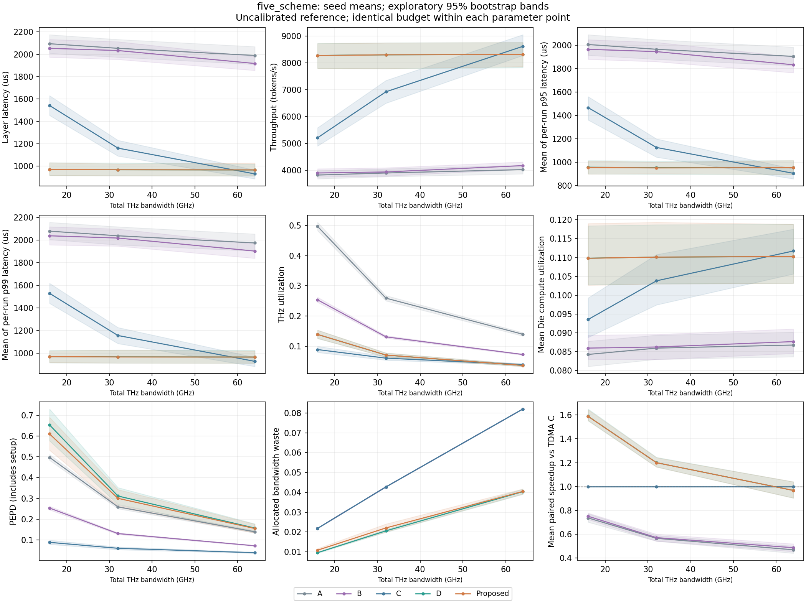
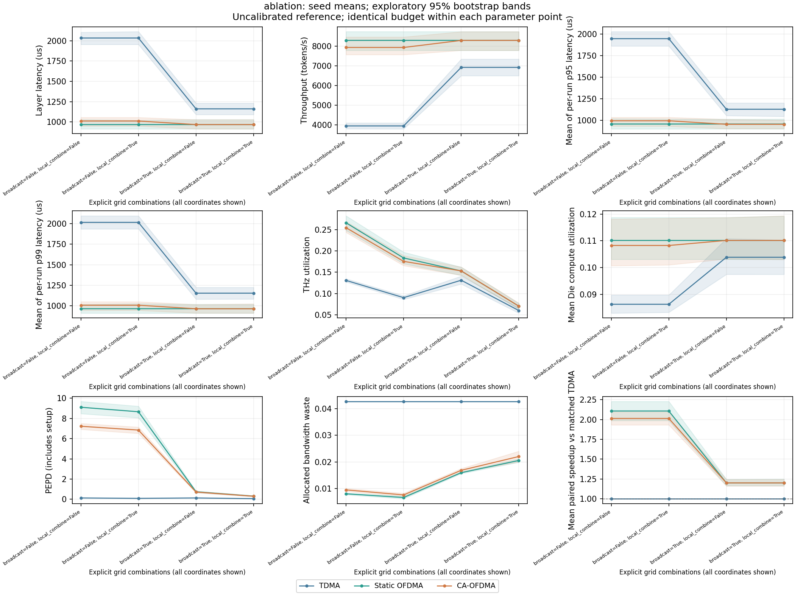
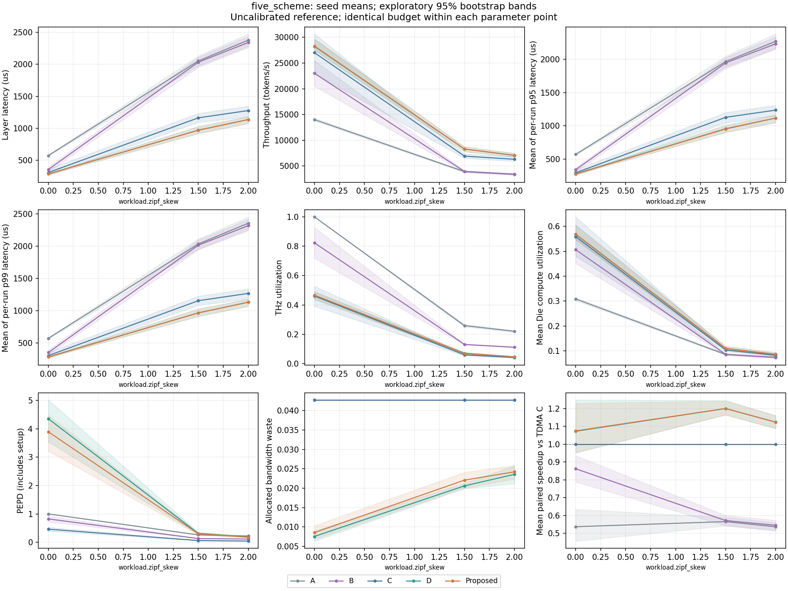
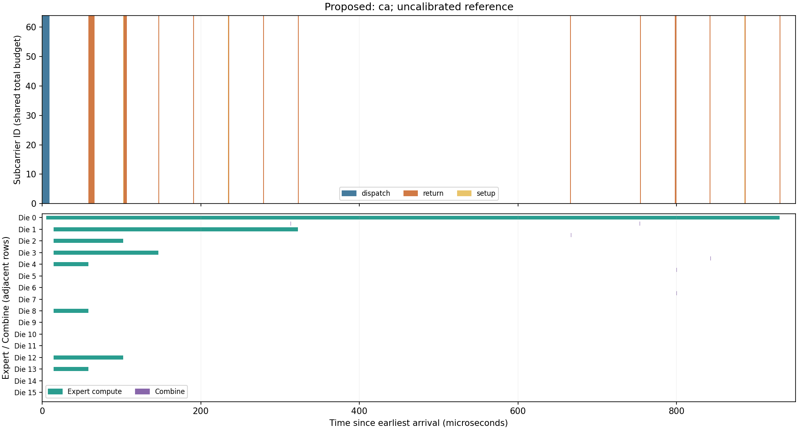
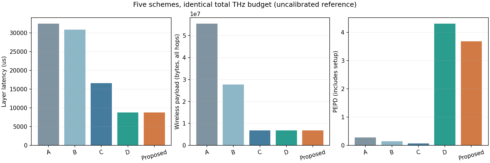

# 仿真结果与结论

这些结果来自已执行的离散事件仿真，使用未标定的参考参数。它们说明当前模型下的数据流与调度行为，不构成真实 THz/PIM 硬件预测或 DeepSeek-V3 完整层性能结论。

[图表索引](evidence/README.md)、[完整数据下载与解压](evidence/archives/README.md)、[统计规则](STAGE5.md)和[验证记录](VALIDATION_STAGE5.md)可用于追溯结论。本文的统计表来自归档 CSV，没有挑选有利种子。

## 运行条件与归档来源

原环境切换后，未提交的完整明细丢失，因此在 **2026-11-02** 使用提交 `49f501f` 的 Python 模块、锁定依赖和原配置重新运行五阶段入口。新生成的数据包与已提交的历史验证记录分别标识；第一至第四阶段归档是当前 0.5.0 程序对历史入口的重建，不冒充当时旧版本的原始文件。源码与模型公式没有修改。

环境为 CPython 3.12.14、NumPy 2.3.5、Pandas 2.2.3、Matplotlib 3.10.8。第五阶段三套计划各运行两遍，共 1,270 次仿真；原验证记录为 179 项测试通过、六次离线审计通过、11,486 对文件逐字节一致。重建运行、归档解压审计及历史数据对照结果保存在[发布校验记录](evidence/archives/publication_validation.json)。

| 第五阶段计划 | 唯一点 | 种子数 | 每点方案数 | 每遍运行数 | 执行范围 |
|---|---:|---:|---:|---:|---|
| 小模型 smoke | 5 | 5 | 5 | 125 | 两遍 |
| broadcast/Local Combine 独立消融 | 4 | 5 | 3 | 60 | 两遍 |
| 八类参数代表性扫描 | 18 | 5 | 5 | 450 | 两遍 |
| 完整 PDF 单因素取值计划 | 29 | 5 | 5 | 725 | 仅预览，未全部运行 |

代表性基准为 d=7168、h=2048、E=256、8 tokens、Top-8、16 Dies、64 子载波、总 THz 带宽 32 GHz、ηSE=2、ηPHY=0.8、Zipf s=1.5、BF16 activation。每 Die 参考算力 10 TFLOP/s、内存带宽 1 TB/s；batch 窗口 5 μs、cap=16、reuse tile=4；setup=100 ns。其他时延、CA 权重及归一化参数见[完整配置](../configs/stage5_reference.json)。

路由 seeds 为 11/23/37/51/71。独立重复单位是种子，样本 std 使用 ddof=1；加速比先算每个 seed 的 `latency_C / latency_scheme` 再求均值。95% bootstrap 带是有限种子的探索性区间，不包含硬件不确定性或多重比较显著性。p95/p99 图显示每次运行的分位数再跨种子求均值。

同一参数点内五方案共用实际 trace、完整 PHY 预算、计算资源及延迟参数。带宽扫描在不同横坐标有意改变总 B；同一横坐标内所有方案共用该 B。Die 数扫描固定每 Die 算力，因此总计算资源随 Die 数变化，Source/placement 也会变化。

## 五方案基准

| 方案 | 数据流/调度 | 层延迟均值（μs） | 样本 std（μs） | 相对 C 的配对加速比均值 |
|---|---|---:|---:|---:|
| A | 每 expert 两跳 Base relay，TDMA | 2053.465 | 101.388 | 0.565414 |
| B | 每 expert 直接 P2P，TDMA | 2033.509 | 98.477 | 0.571233 |
| C | 广播 + Local Combine，TDMA | 1161.563 | 95.477 | 1.000000 |
| D | 广播 + Local Combine，静态 OFDMA | 968.243 | 72.789 | 1.200019 |
| Proposed | 广播 + Local Combine，CA-OFDMA | 968.243 | 72.094 | 1.199916 |

D/Proposed 相对 C 的配对加速比约为 1.2，但两者均值相近，不能据此声称 CA 优于静态 OFDMA。A/B 与 C 同时改变数据流语义，其差异不能全部归因于 OFDMA。

来源：[aggregate.csv](evidence/stage5/paper_sample/aggregate.csv)，基准点 `p_355341e8153208d6`；[逐 seed 指标](evidence/stage5/paper_sample/raw_results.csv)、[配对结果](evidence/stage5/paper_sample/paired_results.csv)、[共同预算检查](evidence/stage5/paper_sample/fairness.csv)。

## 带宽增加不保证 OFDMA 相对 TDMA 更有利

| 总 THz 带宽 | C 均值（μs） | D 均值（μs） | Proposed 均值（μs） | Proposed 相对 C 的配对加速比 |
|---|---:|---:|---:|---:|
| 16 GHz | 1542.549 | 970.931 | 970.931 | 1.589055 |
| 32 GHz | 1161.563 | 968.243 | 968.243 | 1.199916 |
| 64 GHz | 931.434 | 966.899 | 966.899 | 0.967236 |

64 GHz 时，D/Proposed 平均层延迟高于 C。频谱切分改变传输完成顺序、batch 形成及计算就绪时刻；并行流增多本身不会增加总链路容量。图中保留了加速比小于 1 的结果。

[SVG](evidence/stage5/plots/phy_total_bandwidth_hz.svg)、[参数坐标](evidence/stage5/paper_sample/views.csv)。固定总带宽、Nsc=16/64/256 的三个点中，D/Proposed 延迟均值均约 968.243 μs；子载波数不是额外带宽，PEPD 改变也不等于延迟收益。

## 广播与 Local Combine 的独立消融

每种开关组合均在 TDMA/static/CA 三种 PHY 上运行。这些是独立消融，不改写正式五组定义。下表为每次运行的 payload byte 跨种子均值，三种 PHY 的流量相同。

| 广播 | Local Combine | Dispatch bytes | Return bytes | 总 payload bytes |
|---|---|---:|---:|---:|
| off | off | 814284.8 | 814284.8 | 1628569.6 |
| off | on | 814284.8 | 309657.6 | 1123942.4 |
| on | off | 114688.0 | 814284.8 | 928972.8 |
| on | on | 114688.0 | 309657.6 | 424345.6 |

广播减少重复输入发送，Local Combine 减少返回副本，最终向量已核对等价。但仅开启 Local Combine 没有降低这组配置的层延迟：广播开启时，TDMA 均值从 1161.513 μs 变为 1161.563 μs。通信 byte 减少不能单独证明端到端加速，Combine 开销与关键依赖仍会影响结果。

来源：[原始数据](evidence/stage5/ablation/raw_results.csv)、[统计汇总](evidence/stage5/ablation/aggregate.csv)、[SVG](evidence/stage5/plots/grid.svg)。

## 路由偏斜与其他参数

| Zipf s | C 均值（μs） | D 均值（μs） | Proposed 均值（μs） | 三方案总 payload bytes 均值 |
|---|---:|---:|---:|---:|
| 0 | 305.365 | 283.992 | 283.466 | 837222.4 |
| 1.5 | 1161.563 | 968.243 | 968.243 | 424345.6 |
| 2 | 1276.068 | 1135.139 | 1135.139 | 326860.8 |

在这些观测点，路由更偏斜时无线流量减少，但层延迟增加。流量、并发度和层延迟需要结合计算队列分析，不能仅凭广播节省的 byte 数预测收益。

其余扫描均已归档：[token 数](evidence/stage5/plots/workload_num_tokens.png)、[Die 数](evidence/stage5/plots/topology_num_dies.png)、[Top-k](evidence/stage5/plots/model_top_k.png)、[子载波数](evidence/stage5/plots/phy_num_subcarriers.png)、[频谱效率](evidence/stage5/plots/phy_spectral_efficiency.png)、[FP8/BF16 字节配置](evidence/stage5/plots/model_activation_precision.png)。[完整索引](evidence/stage5/README.md)包含 PNG/SVG 和全部时间线。

## 时间线与 128-token 对照

时间线上半部展示实际子载波占用，下半部展示每 Die 的计算和 Combine，空白为相应资源未占用。每张图对应单 seed 的事件轨迹，不是均值轨迹。第五阶段的代表性时间线取计划第一个参数点及第一个种子；论文维度扫描对应 **FP8、8 tokens、seed=11**，不是上面的 BF16 基准点。

[全部 13 条第五阶段时间线](evidence/stage5/README.md)包含五方案及消融的三种 PHY。

第四阶段入口另有 **128 tokens、Top-8、E=256、16 Dies、32 GHz、seed=42** 的五组对照，每方案完成 1024 个 expert assignments；这是单 seed 示例，未并入第五阶段统计。

| 方案 | 层延迟（ms） | 无线 payload bytes（含 relay hop） |
|---|---:|---:|
| A | 32.447331520 | 55451648 |
| B | 30.879834592 | 27725824 |
| C | 16.610862384 | 6866944 |
| D | 8.787671303 | 6866944 |
| Proposed | 8.787653989 | 6866944 |

[比较 CSV](evidence/stage4/zipf/comparison.csv)、[共同预算检查](evidence/stage4/zipf/fairness.json)、[第四阶段全部图表](evidence/stage4/README.md)。第一至第三阶段的手算、批处理、Combine on/off 和 Return 反馈图表见[阶段索引](evidence/README.md)。

## 验证边界

已验证配置内的公式、事件因果、频谱互斥、bit/byte 守恒、计算排队、加权归并、数值等价、导出后的统计重算及复现。文件一致或程序可运行本身不能证明模型正确。

Base/Gate、硬件算力/带宽、FIFO Combine、理想多流收发、零切换开销和固定净速率尚未硬件标定。输出使用合成 float64；FP8/BF16 仅影响 byte 数，未模拟真实 FFN、量化误差、shared expert、SNR/功率或重传。完整 PDF 的 725 次单因素扫描仅做预览，未执行点没有图表或性能结论。
