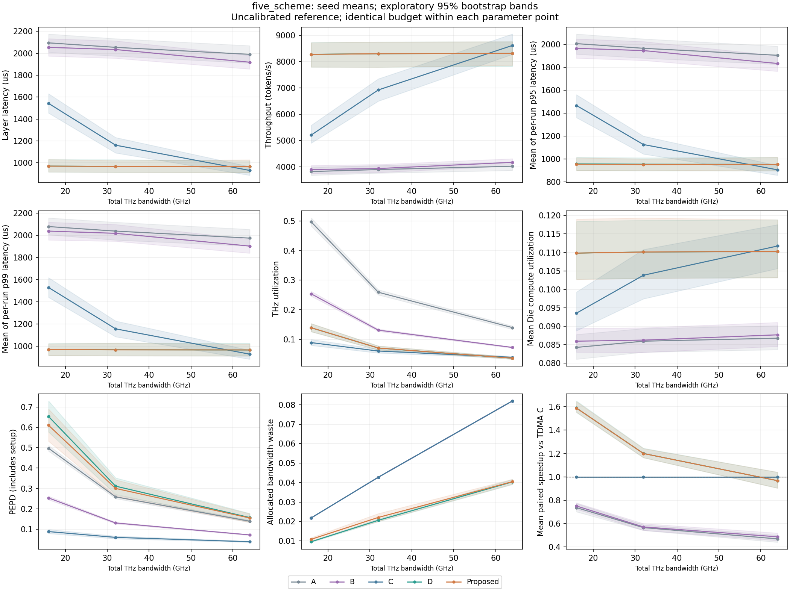

# 图表与实验数据索引

这里保存五个阶段的可浏览图片、原始指标和完整数据包。[结论报告](../RESULTS.md)解释统计方法、共同带宽条件、实测差异和限制；图片也可直接在 GitHub 页面查看。

| 阶段 | 图表与指标 | 说明 |
|---|---|---|
| 1 | [单 token 参考](stage1/README.md) | 22 μs 手算用例及论文维度参考 |
| 2 | [Dispatch 与计算](stage2/README.md) | 广播、batch/reuse、trace、Zipf；非完整层延迟 |
| 3 | [Combine 与 Return](stage3/README.md) | Local Combine on/off、回传反馈及 Zipf |
| 4 | [五方案对照](stage4/README.md) | 四种配置，各含比较图和五方案时间线 |
| 5 | [参数扫描与消融](stage5/README.md) | 11 组 PNG/SVG 扫描图、13 条时间线和多种子 CSV |

[下载七个完整结果包](archives/README.md)，解压后可得到首遍全部明细；第二遍一致性清单一并保留。图表对应 2026-11-02 的重建结果，原已提交的第五阶段历史测试/统计证据保留并作对照。[发布校验记录](archives/publication_validation.json)说明哪些文件与历史记录一致、哪些审计已实际执行。

所有结果都使用未标定参考参数；没有真实硬件标定、真实 FFN/量化/shared expert 验证，也没有将完整计划的 dry-run 当作实验执行。
