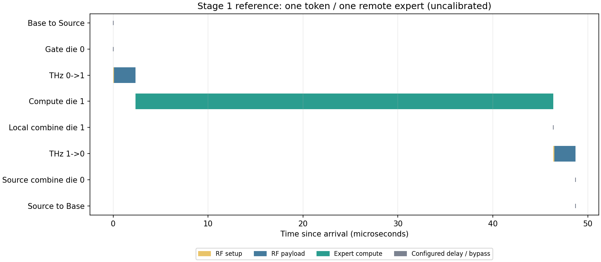

# 第 1 阶段结果：单 token 手算参考路径

本目录为 2026-11-02 使用 0.5.0 代码和原阶段配置重新运行的结果，来源 `stage1-rebuild-hokyd24e`。每个配置运行两遍，全部导出逐字节相同。历史阶段当时的版本和测试记录保留在原验证文档；这里不将重建文件当作当时的原件。

[返回总索引](../README.md) · [结论报告](../../RESULTS.md) · [完整数据包](../archives/stage1.tar.xz) · [重复性清单](reproducibility.json) · [当前代码共用测试日志](rebuild_tests.log)

## 图片和指标

| 用例 / 方案 | 图表 | 数据 |
|---|---|---|
| reference | [timeline](reference/timeline.png) | [summary.csv](reference/summary.csv) |
| tiny | [timeline](tiny/timeline.png) | [summary.csv](tiny/summary.csv) |

