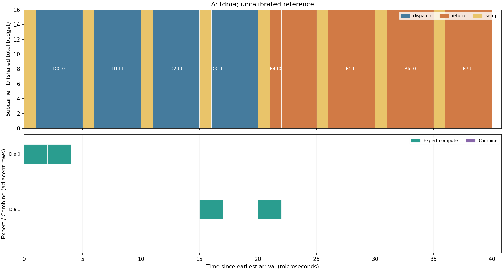

# 第 4 阶段结果：五方案同带宽对照

本目录为 2026-11-02 使用 0.5.0 代码和原阶段配置重新运行的结果，来源 `stage4-rebuild-msbl13sq`。每个配置运行两遍，全部导出逐字节相同。历史阶段当时的版本和测试记录保留在原验证文档；这里不将重建文件当作当时的原件。

[返回总索引](../README.md) · [结论报告](../../RESULTS.md) · [完整数据包](../archives/stage4.tar.xz) · [重复性清单](reproducibility.json) · [当前代码共用测试日志](rebuild_tests.log)

## 图片和指标

| 用例 / 方案 | 图表 | 数据 |
|---|---|---|
| concurrent/A | [timeline](concurrent/A/timeline.png) | [summary.csv](concurrent/A/summary.csv) |
| concurrent/B | [timeline](concurrent/B/timeline.png) | [summary.csv](concurrent/B/summary.csv) |
| concurrent/C | [timeline](concurrent/C/timeline.png) | [summary.csv](concurrent/C/summary.csv) |
| concurrent/D | [timeline](concurrent/D/timeline.png) | [summary.csv](concurrent/D/summary.csv) |
| concurrent/Proposed | [timeline](concurrent/Proposed/timeline.png) | [summary.csv](concurrent/Proposed/summary.csv) |
| concurrent | [comparison](concurrent/comparison.png) | [comparison.csv](concurrent/comparison.csv) |
| limited/A | [timeline](limited/A/timeline.png) | [summary.csv](limited/A/summary.csv) |
| limited/B | [timeline](limited/B/timeline.png) | [summary.csv](limited/B/summary.csv) |
| limited/C | [timeline](limited/C/timeline.png) | [summary.csv](limited/C/summary.csv) |
| limited/D | [timeline](limited/D/timeline.png) | [summary.csv](limited/D/summary.csv) |
| limited/Proposed | [timeline](limited/Proposed/timeline.png) | [summary.csv](limited/Proposed/summary.csv) |
| limited | [comparison](limited/comparison.png) | [comparison.csv](limited/comparison.csv) |
| tiny/A | [timeline](tiny/A/timeline.png) | [summary.csv](tiny/A/summary.csv) |
| tiny/B | [timeline](tiny/B/timeline.png) | [summary.csv](tiny/B/summary.csv) |
| tiny/C | [timeline](tiny/C/timeline.png) | [summary.csv](tiny/C/summary.csv) |
| tiny/D | [timeline](tiny/D/timeline.png) | [summary.csv](tiny/D/summary.csv) |
| tiny/Proposed | [timeline](tiny/Proposed/timeline.png) | [summary.csv](tiny/Proposed/summary.csv) |
| tiny | [comparison](tiny/comparison.png) | [comparison.csv](tiny/comparison.csv) |
| zipf/A | [timeline](zipf/A/timeline.png) | [summary.csv](zipf/A/summary.csv) |
| zipf/B | [timeline](zipf/B/timeline.png) | [summary.csv](zipf/B/summary.csv) |
| zipf/C | [timeline](zipf/C/timeline.png) | [summary.csv](zipf/C/summary.csv) |
| zipf/D | [timeline](zipf/D/timeline.png) | [summary.csv](zipf/D/summary.csv) |
| zipf/Proposed | [timeline](zipf/Proposed/timeline.png) | [summary.csv](zipf/Proposed/summary.csv) |
| zipf | [comparison](zipf/comparison.png) | [comparison.csv](zipf/comparison.csv) |

每个用例的 `fairness.json` 核对五组共同预算、工作负载、计算/时延配置及数值等价。zipf 是 128-token 单 seed 示例，不与第五阶段多种子统计混合。
