# V-Die 单MoE层完整仿真报告

批准版本：VDIE-FULL-v1.0-review-1；用户确认日期：2026年11月5日（Asia/Shanghai）。

全部 4,020 条计划记录完成；FP8端到端数值误差验收未通过。experiments_complete=true，complete=false。

批准的NRMSE上限仍为5%，未改阈值、未删除失败断言。该失败与时序/能耗描述符实验分开报告，不能宣称已满足规范的全部验收要求。

## 1. 仿真目标

测量Base上输入就绪至Base收到输出的单MoE层延迟与模型估计能耗，通过完整2³消融分离动态OFDMA、Dispatch广播、Local Combine及其交互作用；另与包粒度强TDMA比较。

层内计算、共享内存接口、无线控制/数据服务、半双工冲突、缓冲区背压、shared专家和本地归并进入同一事件模型；不通过总字节除总带宽估算整层时间。

## 2. 仿真简述

数据路径为Base输入→owner Gate/Top-k→Dispatch→专家计算→可选Local Combine→owner最终Combine→Base输出。Python组织配置、输入、统计、审计与报告，本地C++扩展加速整数皮秒离散事件内核。计算/DMA按5ns主时钟对齐，无线按1ps事件分辨率处理，跨帧保留分数bit服务。

文本来自MohamedRashad/ChatGPT-prompts，使用三个模型冻结revision中的官方tokenizer，不加特殊token或聊天模板。路由为受控合成，标记dataset_tokens_synthetic_router；没有加载预训练模型权重或采集真实隐藏状态。Decode重放回复token，单层耗时不代表完整模型TBT。

权重预驻留，计本层热态执行。Attention、KV cache、其它层、初始化权重装载、外部主存及residual add均不在计时边界内。M3每token只计算两个shared分支，owner/buddy各一个。

| 模型 | 隐藏/专家中间维度 | routed / Top-k / shared | 每Die驻留字节 |
|---|---|---|---|
| M1 | 2880 / 2880 | 32 / 4 / 0 | 54,083,520 |
| M2 | 2048 / 768 | 128 / 8 / 0 | 42,214,464 |
| M3 | 2560 / 1536 | 64 / 6 / 2 | 63,355,280 |

两个能耗账本均含计算、向量处理、eDRAM读写、刷新、泄漏、RF及控制待机；baseband_stress再加未标定的在线EQ和OFDMA额外基带proxy。默认刷新约3.02545W/Die、16Die约48.40727W，保持连续后台积分。这些是参数外推，不是目标芯片实测功耗。

## 3. 仿真参数表

下表包含全部211项原规范机器参数。取值、单位、含义与依据来自已批准规范，运行期未改变模型参数或5%数值门槛；扫描值见experiment组。U/P/C/D/A分别表示用户固定、论文记录、官方配置、设计选择、未验证外推。参数表CSV另保留逐项文献URL，完整引用见附录。

### spec

| 参数键 | 值 | 单位 | 含义与规则 | 依据 |
|---|---|---|---|---|
| spec.version | "1.0" | — | 本次执行规范版本；2026-11-04 核对文献 | D |

### simulation

| 参数键 | 值 | 单位 | 含义与规则 | 依据 |
|---|---|---|---|---|
| simulation.engine | "discrete_event" | — | Python 架构级离散事件仿真；不执行完整 LLM | D |
| simulation.time_unit_ps | 1 | ps | 事件时间使用整数皮秒，避免浮点累积误差 | D |
| simulation.seed_list | [20261104, 20261105, 20261106, 20261107, 20261108] | — | 五组配对随机种子；相同 trace 用于所有 baseline | D |
| simulation.fp8_numeric_test_tokens | 16 | token | 小尺寸数值校验的 token 数；性能仿真不实际做数十亿次乘加 | D |
| simulation.numeric_test_d | 64 | element | 小尺寸数值校验隐藏维度 | D |
| simulation.numeric_test_h | 32 | element | 小尺寸数值校验专家中间维度 | D |
| simulation.fp32_rtol | 1e-05 | — | 无链路量化时不同 Combine 顺序的相对误差容限 | D |
| simulation.fp32_atol | 1e-06 | — | 无链路量化时的绝对误差容限 | D |
| simulation.fp8_nrmse_limit | 0.05 | — | 受控随机小算例的 FP8 输出归一化误差阈值；不是模型精度保证 | D |
| simulation.fp8_cosine_min | 0.99 | — | 上述小算例的余弦相似度检查阈值 | D |

### models.M1

| 参数键 | 值 | 单位 | 含义与规则 | 依据 |
|---|---|---|---|---|
| models.M1.repo | "openai/gpt-oss-20b" | — | 模型及其 tokenizer 的官方仓库 | [P3] [C1] [C4] |
| models.M1.total_params_b | 20.91 | 10^9 parameters | 整模型参数量，仅说明规模；不乘入单层开销 | [P3] [C1] [C4] |
| models.M1.active_params_b | 3.61 | 10^9 parameters/token | 整模型激活参数量；各论文统计口径不完全相同 | [P3] [C1] [C4] |
| models.M1.d_model | 2880 | element | 单层输入、输出 activation 长度 | [P3] [C1] [C4] |
| models.M1.d_ff | 2880 | element | 每个 routed expert 的中间维度 | [P3] [C1] [C4] |
| models.M1.routed_experts | 32 | expert/layer | 本层独立 routed expert 数量 | [P3] [C1] [C4] |
| models.M1.top_k | 4 | expert/token | 每 token 选择的不重复 routed expert 数量 | [P3] [C1] [C4] |
| models.M1.shared_experts | 0 | expert/layer | 每 token 必须计算的 shared expert 数；不占 top-k | [P3] [C1] [C4] |
| models.M1.shared_d_ff | 0 | element | 每个逻辑 shared expert 的中间维度；M3 官方融合宽度为 3072 | [P3] [C1] [C4] |
| models.M1.transformer_layers | 24 | layer | 整模型层数，仅用于标识模型 | [P3] [C1] [C4] |
| models.M1.moe_layers | 24 | layer | 整模型 MoE 层数；本任务只计其中一层 | [P3] [C1] [C4] |
| models.M1.layer_index | 1 | zero-based | 统一选第 2 个 Transformer block 的 MoE；M3 第 1 个 block 是 dense | D；结构依据 [P3] [C1] [C4] |
| models.M1.expert_linear_bias | true | bool | M1 的 gate/up/down 含 bias；M2/M3 不含 | [P3] [C1] [C4] |
| models.M1.router_linear_bias | true | bool | M1 router 线性映射有 bias | [P3] [C1] [C4] |
| models.M1.router_correction_fp32 | false | bool | M3 的专家选择 correction bias；合成 trace 设零，真 trace 保留 | [C5]；默认值 D |
| models.M1.activation | "gpt_oss_swiglu" | — | 专家非线性；禁止把三种模型都改成同一激活 | [P3] [C1] [C4] |
| models.M1.swiglu_alpha | 1.702 | — | GPT-oss 自定义 SwiGLU sigmoid 系数 | [C4] |
| models.M1.swiglu_limit | 7.0 | — | GPT-oss gate 上限及 up 分支双侧限幅 | [C1] [C4] |
| models.M1.expert_matrix_params | 24883200 | parameter | 3*d_model*d_ff，三个矩阵的元素总数 | 派生：[P3] [C1] [C4] |
| models.M1.expert_params_including_bias | 24891840 | parameter | 单个专家参数量，M1 加上三个线性 bias | 派生：[P3] [C1] [C4] |
| models.M1.expert_storage_bytes | 24898464 | byte | FP8 矩阵/bias 加所有 FP32 block scales | 派生：模型尺寸 + [P6] 的分块规则 |
| models.M1.router_storage_bytes | 92288 | byte/die | 完整 router 副本及其 scale/bias/correction 的容量 | 派生：模型配置与本规范量化格式 |
| models.M1.resident_bytes_per_die | 54083520 | byte/die | 专家 + router + 固定 4MiB 工作区；必须不超过 64,000,000 | 派生：本规范映射与容量核算 |

### models.M2

| 参数键 | 值 | 单位 | 含义与规则 | 依据 |
|---|---|---|---|---|
| models.M2.repo | "Qwen/Qwen3-30B-A3B" | — | 模型及其 tokenizer 的官方仓库 | [P4] [C2] |
| models.M2.total_params_b | 30.5 | 10^9 parameters | 整模型参数量，仅说明规模；不乘入单层开销 | [P4] [C2] |
| models.M2.active_params_b | 3.3 | 10^9 parameters/token | 整模型激活参数量；各论文统计口径不完全相同 | [P4] [C2] |
| models.M2.d_model | 2048 | element | 单层输入、输出 activation 长度 | [P4] [C2] |
| models.M2.d_ff | 768 | element | 每个 routed expert 的中间维度 | [P4] [C2] |
| models.M2.routed_experts | 128 | expert/layer | 本层独立 routed expert 数量 | [P4] [C2] |
| models.M2.top_k | 8 | expert/token | 每 token 选择的不重复 routed expert 数量 | [P4] [C2] |
| models.M2.shared_experts | 0 | expert/layer | 每 token 必须计算的 shared expert 数；不占 top-k | [P4] [C2] |
| models.M2.shared_d_ff | 0 | element | 每个逻辑 shared expert 的中间维度；M3 官方融合宽度为 3072 | [P4] [C2] |
| models.M2.transformer_layers | 48 | layer | 整模型层数，仅用于标识模型 | [P4] [C2] |
| models.M2.moe_layers | 48 | layer | 整模型 MoE 层数；本任务只计其中一层 | [P4] [C2] |
| models.M2.layer_index | 1 | zero-based | 统一选第 2 个 Transformer block 的 MoE；M3 第 1 个 block 是 dense | D；结构依据 [P4] [C2] |
| models.M2.expert_linear_bias | false | bool | M1 的 gate/up/down 含 bias；M2/M3 不含 | [P4] [C2] |
| models.M2.router_linear_bias | false | bool | M1 router 线性映射有 bias | [P4] [C2] |
| models.M2.router_correction_fp32 | false | bool | M3 的专家选择 correction bias；合成 trace 设零，真 trace 保留 | [C5]；默认值 D |
| models.M2.activation | "silu_glu" | — | 专家非线性；禁止把三种模型都改成同一激活 | [P4] [C2] |
| models.M2.expert_matrix_params | 4718592 | parameter | 3*d_model*d_ff，三个矩阵的元素总数 | 派生：[P4] [C2] |
| models.M2.expert_params_including_bias | 4718592 | parameter | 单个专家参数量，M1 加上三个线性 bias | 派生：[P4] [C2] |
| models.M2.expert_storage_bytes | 4719744 | byte | FP8 矩阵/bias 加所有 FP32 block scales | 派生：模型尺寸 + [P6] 的分块规则 |
| models.M2.router_storage_bytes | 262208 | byte/die | 完整 router 副本及其 scale/bias/correction 的容量 | 派生：模型配置与本规范量化格式 |
| models.M2.resident_bytes_per_die | 42214464 | byte/die | 专家 + router + 固定 4MiB 工作区；必须不超过 64,000,000 | 派生：本规范映射与容量核算 |

### models.M3

| 参数键 | 值 | 单位 | 含义与规则 | 依据 |
|---|---|---|---|---|
| models.M3.repo | "baidu/ERNIE-4.5-21B-A3B-PT" | — | 模型及其 tokenizer 的官方仓库 | [P5] [C3] [C5] |
| models.M3.total_params_b | 21.0 | 10^9 parameters | 整模型参数量，仅说明规模；不乘入单层开销 | [P5] [C3] [C5] |
| models.M3.active_params_b | 3.0 | 10^9 parameters/token | 整模型激活参数量；各论文统计口径不完全相同 | [P5] [C3] [C5] |
| models.M3.d_model | 2560 | element | 单层输入、输出 activation 长度 | [P5] [C3] [C5] |
| models.M3.d_ff | 1536 | element | 每个 routed expert 的中间维度 | [P5] [C3] [C5] |
| models.M3.routed_experts | 64 | expert/layer | 本层独立 routed expert 数量 | [P5] [C3] [C5] |
| models.M3.top_k | 6 | expert/token | 每 token 选择的不重复 routed expert 数量 | [P5] [C3] [C5] |
| models.M3.shared_experts | 2 | expert/layer | 每 token 必须计算的 shared expert 数；不占 top-k | [P5] [C3] [C5] |
| models.M3.shared_d_ff | 1536 | element | 每个逻辑 shared expert 的中间维度；M3 官方融合宽度为 3072 | [P5] [C3] [C5] |
| models.M3.transformer_layers | 28 | layer | 整模型层数，仅用于标识模型 | [P5] [C3] [C5] |
| models.M3.moe_layers | 27 | layer | 整模型 MoE 层数；本任务只计其中一层 | [P5] [C3] [C5] |
| models.M3.layer_index | 1 | zero-based | 统一选第 2 个 Transformer block 的 MoE；M3 第 1 个 block 是 dense | D；结构依据 [P5] [C3] [C5] |
| models.M3.expert_linear_bias | false | bool | M1 的 gate/up/down 含 bias；M2/M3 不含 | [P5] [C3] [C5] |
| models.M3.router_linear_bias | false | bool | M1 router 线性映射有 bias | [P5] [C3] [C5] |
| models.M3.router_correction_fp32 | true | bool | M3 的专家选择 correction bias；合成 trace 设零，真 trace 保留 | [C5]；默认值 D |
| models.M3.activation | "silu_glu" | — | 专家非线性；禁止把三种模型都改成同一激活 | [P5] [C3] [C5] |
| models.M3.expert_matrix_params | 11796480 | parameter | 3*d_model*d_ff，三个矩阵的元素总数 | 派生：[P5] [C3] [C5] |
| models.M3.expert_params_including_bias | 11796480 | parameter | 单个专家参数量，M1 加上三个线性 bias | 派生：[P5] [C3] [C5] |
| models.M3.expert_storage_bytes | 11799360 | byte | FP8 矩阵/bias 加所有 FP32 block scales | 派生：模型尺寸 + [P6] 的分块规则 |
| models.M3.router_storage_bytes | 164176 | byte/die | 完整 router 副本及其 scale/bias/correction 的容量 | 派生：模型配置与本规范量化格式 |
| models.M3.resident_bytes_per_die | 63355280 | byte/die | 专家 + router + 固定 4MiB 工作区；必须不超过 64,000,000 | 派生：本规范映射与容量核算 |

### precision

| 参数键 | 值 | 单位 | 含义与规则 | 依据 |
|---|---|---|---|---|
| precision.activation | "FP8_E4M3FN" | — | 所有矩阵输入、层输入/输出、跨 Die activation/partial 的载荷类型 | U；具体格式参考 [P6] |
| precision.weight | "FP8_E4M3FN" | — | 专家与 router 权重、线性 bias 按 FP8 存储；M1 不沿用原 MXFP4 | U；格式 [P6]；M1 原格式 [P3] |
| precision.accumulator | "FP32" | — | MAC 累加、softmax、路由概率、Combine 累加的内部精度 | D，参考 [P6] 的高精度累加 |
| precision.weight_block | [128, 128] | element | FP8 权重每个二维 block 共用一个 FP32 scale | [P6] §3.3.2；对本架构的采用为 D |
| precision.activation_block | 128 | element | activation 每 token 每 128 元素一个 scale | [P6] §3.3.2 |
| precision.scale_bytes | 4 | byte | 每个 scale 的 FP32 字节数 | D |
| precision.fp8_max | 448 | — | E4M3FN 最大有限值；amax/448 决定 scale | E4M3FN 格式定义，采用 [P6] |
| precision.scale_zero_amax | 1.0 | — | 全零块的 scale，避免除零 | D |
| precision.rounding | "nearest_even_saturate" | — | 最近偶数舍入、有限范围饱和；不得用 INT8 代替 FP8 | D |

### hardware

| 参数键 | 值 | 单位 | 含义与规则 | 依据 |
|---|---|---|---|---|
| hardware.vdies | 16 | die | Expert V-Die 数量 | U |
| hardware.base_dies | 1 | die | Base Die 数量；只作为本层输入/输出端点 | U/按系统描述 |
| hardware.clock_hz | 200000000 | Hz | 主数字时钟；一个周期 5ns，不是 THz 载频 | U |
| hardware.peak_ops_s | 1000000000000 | OP/s/die | FP8 峰值 1TOPS；乘法和加法各计 1 OP | U；OP 口径 [P2] Table II |
| hardware.ops_per_mac | 2 | OP/MAC | 一次乘加计两个操作，防止 2 倍算力错误 | [P2] Table II 脚注 |
| hardware.edram_bytes | 64000000 | byte/die | 64MB 按十进制解释，比 64MiB 更保守；所有驻留内容合计受限 | U；单位约定 D |
| hardware.workspace_bytes | 4194304 | byte/die | 4MiB 工作区从上述 64MB 内扣除，不额外赠送容量 | D |
| hardware.buffer_partition_bytes | [524288, 1048576, 1048576, 1048576, 524288] | byte | 依次为权重 tile 双缓冲、RX、TX、activation/FP32 partial、控制描述符 | D |
| hardware.tx_return_reserve_bytes | 524288 | byte/die | TX缓冲中至少512KiB保留给Return/Output，避免Dispatch堵塞完成路径 | D |
| hardware.rx_return_reserve_bytes | 524288 | byte/die | RX缓冲中至少512KiB保留给Return，防止Dispatch占满接收空间 | D |
| hardware.partial_owner_reserve_bytes | 262144 | byte/die | activation/partial分区中256KiB保留给owner最终累加器，余下用于专家中间值 | D |
| hardware.owner_inflight_limit | 16 | token/die | 每 owner 最多保留 16 个未完成 token，超限在 Base 排队 | D |
| hardware.vector_lanes | 64 | element-OP/cycle | Top-k、激活函数、scale、Combine 的向量处理宽度 | D |
| hardware.compute_utilization | 1.0 | ratio | tile 内理想计算效率；边界用实际尺寸，不凭空填充全 tile | D；强制做敏感性检验 |
| hardware.compute_setup_cycles | 2 | cycle/task | 一项矩阵或向量任务的固定启动开销 | D |
| hardware.compute_voltage_v | 1.1 | V | 目标计算域工作电压，按 [P2] Fig.21 约 215MHz 点选择以覆盖 200MHz | [P2] Fig.21 图读近似 + D |
| hardware.edram_voltage_v | 0.9 | V | eDRAM 采用独立电压域；不是将两个论文工艺宣称为同一芯片 | [P7] Table 1；集成为 A |
| hardware.temperature_c | 27 | degC | eDRAM 参数标定温度；不模拟热反馈 | [P7] Table 1 |

### compute

| 参数键 | 值 | 单位 | 含义与规则 | 依据 |
|---|---|---|---|---|
| compute.tile_m | 16 | token | 专家一次最多合并 16 个已到达 token | D |
| compute.tile_n | 128 | element | 输出维度 tile 宽度 | D，匹配 [P6] 分块 |
| compute.tile_k | 128 | element | 归约维度 tile 宽度 | D，匹配 [P6] 分块 |
| compute.batch_wait_cycles | 20 | cycle | 最老 token 最多等 100ns 聚批；满 16 或上游窗口关闭可提前发射 | D |
| compute.activation_ops_per_element | 8 | vector-OP | 普通 SwiGLU 每中间元素的保守等效成本 | A：非线性电路未提供，固定于全部 baseline |
| compute.gpt_activation_ops_per_element | 12 | vector-OP | 含限幅与额外乘加的 GPT-oss SwiGLU 成本 | A；函数依据 [C4] |
| compute.softmax_ops_per_element | 8 | vector-OP | softmax/归一化的等效标量成本 | A |
| compute.quantize_ops_per_element | 3 | vector-OP | amax、缩放、转换的等效成本；scale 决策按 128 元素组 | A |
| compute.vector_energy_multiplier | 4.0 | ratio | FP32 向量操作相对 FP8 等效 OP 的能耗倍率 | A；必须随能耗系数一起检验 |
| compute.energy_scale | 1.0 | ratio | FP16 原型迁移到 FP8 的额外修正默认不赠送降耗 | A；1 表示不作位宽线性减半 |
| compute.extra_idle_power_w | 0.01 | W/die | 计算/控制域额外待机功耗，独立于 eDRAM 与 RF | A；[P2] 未给本目标 Die 待机功耗 |
| compute.base_io_idle_power_w | 0.01 | W | 只计 Base 在本层边界内的 I/O 控制待机 | A；不计 Base 的 Attention 等计算 |

### memory

| 参数键 | 值 | 单位 | 含义与规则 | 依据 |
|---|---|---|---|---|
| memory.banks | 64 | bank/die | eDRAM 逻辑 bank 数 | D |
| memory.external_bytes_per_bank_cycle | 16 | byte/cycle | 每 bank 对计算/DMA 可提供 128bit，读写共享额度 | D |
| memory.bandwidth_scale | 1.0 | ratio | 有效用户端口吞吐相对64bank×16B/cycle的倍率；固定访问时延不缩放 | D；敏感性取0.5/1/2 |
| memory.access_latency_cycles | 1 | cycle | 最小访问时延 5ns；文献 2ns 访问能力向 200MHz 周期取整 | [P7] §3；向目标时钟换算 D |
| memory.read_pj_bit | 0.025 | pJ/bit | 小宏 read 能量，25fJ/bit；非 64MB 成品实测 | [P7] §3，电路仿真；容量扩展 A |
| memory.write_pj_bit | 0.04 | pJ/bit | 小宏 write 能量，40fJ/bit | [P7] §3，电路仿真；容量扩展 A |
| memory.refresh_pj_bit | 0.065 | pJ/bit/refresh | 一次完整 read+write refresh，65fJ/bit | [P7] §3 |
| memory.refresh_period_ps | 11000000 | ps | 11us 的标称保持/刷新周期；6us 作为保守敏感性点 | [P7] Table 1；最坏条件见 §3 |
| memory.leakage_pw_bit | 1.25 | pW/bit | 按 Table 1 取泄漏，正文另一工作条件为 0.93；不得混用 | [P7] Table 1 |
| memory.refresh_blocks_user_port | false | bool | 为 refresh 保留内部端口，用户端口不被阻塞；仍全额计刷新能量 | [P7] internal-refresh 模式；大容量集成 A |
| memory.refresh_scope | "entire_capacity" | — | 每个已启用 Die 的全部 64MB 保持数据；不靠 baseline 改刷新范围 | D，保守配置 |
| memory.energy_scale | 1.0 | ratio | 小宏扩展到64MB的read/write/refresh能量修正；不改变单列的bitcell泄漏，主值1为乐观proxy | A；强制检验 1/2/4 |

### mapping

| 参数键 | 值 | 单位 | 含义与规则 | 依据 |
|---|---|---|---|---|
| mapping.routed | "expert_id_mod_16" | — | routed expert e 放在 e mod 16；不复制、不切分 | D |
| mapping.owner | "request_ordinal_mod_16" | — | 一个请求的所有 token 固定 owner=req_ordinal mod 16 | D |
| mapping.shared | "parity_replica_pair" | — | M3：S0 在偶数 Die、S1 在奇数 Die各8份；token 只用 owner 和 owner xor 1 两份 | D；原 shared 宽度依据 [C3] [C5] |
| mapping.router_replicas | 16 | copy | 每 Die 有完整且相同的 router；每 token 仅 owner 执行一次 Gate | D，符合用户数据流 |
| mapping.warm_weights | true | bool | 单层全部权重预驻留；不计启动装载，不发生层间换权重 | D，任务只比较一层热态输入到输出 |

### radio

| 参数键 | 值 | 单位 | 含义与规则 | 依据 |
|---|---|---|---|---|
| radio.groups_per_vdie | 2 | group/die | Base 通信组与 peer 通信组各一组 | U |
| radio.channels_per_group | 1 | channel/group | 每组按论文1的一条物理通道计，不把双通道 264Gb/s 给每组 | D；[P1] 通道定义 |
| radio.base_groups | 1 | group | Base 有一条聚合接入信道；不是16条独立满带宽链路 | D，避免扩张 Base 带宽 |
| radio.carrier_hz | 153800000000 | Hz | 实测锁定本振频率 153.8GHz，约 0.154THz | [P1] §V / Fig.21 |
| radio.reference_bandwidth_hz | 45000000000 | Hz | 5层/50um 模拟链路约45GHz带宽，仅作频谱约束背景，不拿载频算速率 | [P1] §II-B，EM 仿真 |
| radio.ptp_raw_bps | 132000000000 | bit/s/channel | 有离线 EQ 的单通道点对点峰值 | [P1] §V / Fig.25–26 / Table II |
| radio.broadcast_raw_bps | 80000000000 | bit/s/channel | 较长路径广播实测80Gb/s；主实验不使用更乐观124Gb/s | [P1] §V / Fig.27(b)，after EQ |
| radio.rate_scale | 1.0 | ratio | 16节点覆盖、耦合/干扰与新PHY带来的未知降额；全部方法一起缩放 | A；[P1] 未验证16节点全互连 |
| radio.half_duplex_per_group | true | bool | 同组同一时刻 TX 或 RX；不同组可并发，不能将同组当全双工 | D，符合 [P1] TX/RX/OFF 切换 |
| radio.spatial_reuse | false | bool | 同一介质内不重用相同 RU；16节点共享总频谱预算 | D，保守互扰模型 |
| radio.independent_groups | true | bool | Base 介质与 peer 介质可并行，二者硬件参数相同 | U；两组足够隔离是 A |
| radio.rx_pipeline_cycles | 2 | cycle | 完整包接收后的数字处理延迟 10ns | A |
| radio.propagation_delay_ps | 20 | ps | 短距离传播延迟，仅架构占位，非16-Die实测 | A |
| radio.residual_packet_error | 0.0 | probability | 主实验假设可靠服务；不从两/四层 BER 外推16节点 BER | A；不做物理链路可靠性结论 |
| radio.multicast_receivers | "destination_mask" | — | 控制时段所有节点监听；载荷仅目的 Die 启用接收前端 | D；需对 all_non_source 接收方式做敏感性检验 |

### mac

| 参数键 | 值 | 单位 | 含义与规则 | 依据 |
|---|---|---|---|---|
| mac.frame_cycles | 20 | cycle | TDMA/OFDMA 统一100ns调度帧，全部基线一致 | D |
| mac.control_cycles | 4 | cycle/frame | 20ns控制预算下限；降额时按报告/grant字节延长，并从数据窗口扣除 | A |
| mac.guard_cycles | 1 | cycle/frame | 5ns 保护/方向切换，从数据窗口扣除 | A |
| mac.queue_report_bytes | 8 | byte/node/frame | 每节点每组只报告一个最高优先级HOL候选的mask、bytes、age/type和credit | D |
| mac.grant_header_bytes | 8 | byte/frame | 调度grant固定头，包含帧号/状态及CRC | D |
| mac.grant_bytes_per_ru | 4 | byte/RU | 每RU发送者/目的mask/方向映射，T模式仍发同长度grant | D |
| mac.arbitration_cycles | 1 | cycle/frame | 控制报告结束到grant的数字仲裁预算；作为固定并行硬件假设 | A |
| mac.peer_arbiter_die | 0 | die_id | peer介质由Die0仲裁；base介质由Base仲裁，控制通信和固定仲裁延迟显式计费 | D |
| mac.fft_size | 256 | bin | OFDMA 服务模型的归一化子载波格点数；不是已有THz芯片参数 | D |
| mac.data_subcarriers | 224 | bin | 载荷格点，其余用于 pilot/guard | D |
| mac.pilot_subcarriers | 16 | bin | 归一化导频开销 | D |
| mac.guard_subcarriers | 16 | bin | 归一化频域保护开销 | D |
| mac.cp_samples | 16 | sample | 归一化循环前缀开销；额外效率=224/(256+16) | D |
| mac.resource_units | 16 | RU | 每RU含14个数据格点；按帧动态分配，绝不每个RU都给132Gb/s | D |
| mac.starvation_limit_frames | 16 | frame | 等待达到16帧的 flow 优先，保证有限队列无饥饿 | D |
| mac.packet_header_bytes | 32 | byte/packet | 固定网络头，含token UID/owner/消息类型/目的mask/分片信息 | D |
| mac.crc_bytes | 4 | byte/packet | CRC32开销；虽然主实验不注入误码仍计字节 | D |
| mac.dispatch_entry_bytes | 8 | byte/expert | expert_id 2B + gate weight FP32 4B + flags 2B | D |
| mac.mtu_payload_bytes | 4096 | byte/packet | 最大body，超长分片每片重计header/CRC；不计虚假padding token | D |

### energy

| 参数键 | 值 | 单位 | 含义与规则 | 依据 |
|---|---|---|---|---|
| energy.lo_w_per_node | 0.032 | W/node | 一个共享VCO覆盖本Die两组；热态测试全程保持锁定 | [P1] §III-B为32mW电路仿真；两组共享采用 D |
| energy.tx_increment_w_per_group | 0.00635 | W/active group | (44.7mW−32mW)/2；从L4 TX双通道模块分解 | [P1] §V + 仿真LO功耗，分解值为 A/派生 |
| energy.rx_increment_w_per_group | 0.0056 | W/active group | (43.2mW−32mW)/2；从L3 RX双通道模块分解 | [P1] §V + 仿真LO功耗，分解值为 A/派生 |
| energy.equalizer_extra_w_per_rx | 0.02 | W/active RX group | 补偿论文1未集成的在线均衡功耗；不能标为实测 | A；另检验0/20/100mW |
| energy.ofdma_extra_w_per_active_group | 0.40896428571428567 | W | 完整基带成本压力情景：347mW*(132/112)；不是已测THz OFDMA增量 | [P8] RX参照 + 速率线性外推 A；TX同值为 A |
| energy.report_modes | ["frontend_proxy", "baseband_stress"] | — | 必须同时输出：不含未标定EQ/OFDMA基带的能量；加入上述压力proxy的能量 | D，不能把任一值称为实测整机能耗 |
| energy.compute_pj_op | 0.06980500749971157 | pJ/OP | 21.4TFLOPS/W @0.9V 按V²外推1.1V；FP8修正默认1 | [P2] Table III + 动态能量V²近似 A |

### workload

| 参数键 | 值 | 单位 | 含义与规则 | 依据 |
|---|---|---|---|---|
| workload.dataset | "MohamedRashad/ChatGPT-prompts" | — | HybriMoE引用的ChatGPT Prompts，不是awesome-chatgpt-prompts | [P9] §VI-A5/参考文献30；[D1] |
| workload.split | "train" | — | 官方数据划分；本次页面列360行，执行时记录实际版本行数 | [D1] |
| workload.prompt_column | "human_prompt" | — | Prefill输入文本列 | [D1] |
| workload.response_column | "chatgpt_response" | — | Decode教师强制重放文本列，不宣称本模型生成 | [D1] |
| workload.requests_per_seed | 128 | request | 清洗后无放回采样128个请求；不足时失败，不偷偷复用 | D |
| workload.prefill_batches | [1, 8, 32] | request/batch | 原生prompt长度，每批独立释放并排空 | D；区分prefill/decode参考 [P9] |
| workload.prefill_length_cap | 1024 | token/request | 仅截断长prompt，不补齐短prompt | D；[P9]也报告至1024 token的prefill工作负载 |
| workload.decode_batches | [1, 8, 32, 128] | request/batch | 每活跃请求每轮只产生一个MoE输入token | D |
| workload.decode_steps_cap | 64 | step/request | 最多重放回复前64个token，短回复自然结束 | D |
| workload.decode_refill | false | bool | 同一cohort不回填请求，结束时报告真实有效B的变化 | D |
| workload.arrival | "closed_cohort_barrier" | — | Prefill批内t=0可用；Decode下一轮等本轮全部输出返回再释放 | D，阻止将完整response一次当decode输入 |
| workload.tokenization | "official_plain_text_no_special_tokens" | — | 每模型用官方tokenizer；编码原字段，不加入聊天模板 | D，固定长度口径 |
| workload.input_trace_mode | "dataset_tokens_synthetic_router" | — | 真实数据集token/长度 + 受控合成路由；不伪称真实隐藏状态/真实专家命中 | D，CPU默认可完整执行 |
| workload.routing_profile | "uniform" | — | 主结果：所有专家可交换，无人为热点以保证无偏基线 | D |
| workload.zipf_alpha | 1.2 | — | 热点敏感性：先随机置换expert排名，再按r^(-1.2)生成偏置 | D；不是论文测得的特定模型分布 |
| workload.decode_reuse_probability | 0.0 | probability | 主结果不强加跨token相关性；敏感性另取0.8 | D |
| workload.source_revision | "resolve_and_freeze" | — | 首次读取冻结dataset/tokenizer commit及SHA256；后续全部离线复用 | D，禁止随机跟随main变化 |

### experiment

| 参数键 | 值 | 单位 | 含义与规则 | 依据 |
|---|---|---|---|---|
| experiment.baseline_ids | ["T_P_N", "T_B_N", "T_P_L", "T_B_L", "O_P_N", "O_B_N", "O_P_L", "O_B_L"] | — | T=单载波TDMA，O=动态OFDMA，P=逐目的Die点对点，B=广播，N/L=无/有Local Combine | U；采用完整2³消融 D |
| experiment.strong_tdma_ids | ["TW_P_N", "TW_B_L"] | — | 无固定帧空尾的包粒度work-conserving TDMA压力对照 | D，防止优势仅来自弱TDMA实现 |
| experiment.sensitivity_cases | ["prefill_B32", "decode_B32"] | — | 敏感性与强TDMA用两个代表负载；三模型、五种子全部运行 | D |
| experiment.sensitivity_baseline_ids | ["T_P_N", "O_P_N", "T_B_L", "O_B_L"] | — | 敏感性保留两组可比的T/O配对；完整三因素消融由主实验八组合承担 | D |
| experiment.rate_scale_values | [0.25, 0.5, 1.0] | ratio | 16节点覆盖和新PHY的速率降额 | A |
| experiment.broadcast_rate_values | [80000000000, 124000000000] | bit/s | 实测较长/较短广播路径的两个标定点 | [P1] Fig.27 |
| experiment.compute_utilization_values | [0.5, 0.75, 1.0] | ratio | 不改变1TOPS峰值的有效计算利用率敏感性 | D |
| experiment.memory_bandwidth_scale_values | [0.5, 1.0, 2.0] | ratio | 改变内部bank/DMA有效吞吐，暴露存储瓶颈 | D |
| experiment.memory_energy_scale_values | [1.0, 2.0, 4.0] | ratio | eDRAM小宏到大容量的能量外推敏感性 | A |
| experiment.refresh_period_values_ps | [6000000, 11000000, 100000000] | ps | 6/11us来自[P7]不同条件；100us来自[P10]另一2T设计，只是替代器件情景 | [P7] [P10]；跨设计采用 A |
| experiment.compute_energy_scale_values | [0.5, 1.0, 2.0] | ratio | 检验FP16到FP8、工作电压与电路映射的不确定性 | A |
| experiment.ofdma_extra_power_values_w | [0.0, 0.1, 0.40896428571428567] | W/group | 理想下界、中间情景、[P8]速率归一化压力proxy | D/A；高点依据 [P8] |
| experiment.equalizer_power_values_w | [0.0, 0.02, 0.1] | W/RX group | 在线EQ未实测，检验共同开销 | A |
| experiment.frame_cycles_values | [10, 20, 80] | cycle | 50/100/400ns请求调度粒度；实际帧长由控制报告/grant/仲裁预算和guard共同约束 | D |
| experiment.multicast_rx_values | ["destination_mask", "all_non_source"] | — | 只目标接收与全体监听载荷的能量差异 | A |
| experiment.routing_profiles | ["uniform", "zipf"] | — | 均匀与热点情景，必须分图报告 | D |
| experiment.decode_reuse_values | [0.0, 0.8] | probability | Decode跨步专家集合相关性的受控敏感性 | D |
| experiment.idle_power_values_w | [0.0, 0.01, 0.05] | W/die | 未测待机项敏感性，Base控制项同步采用同值 | A |
| experiment.bootstrap_resamples | 1000 | resample | 对配对请求/cohort统计作bootstrap，输出95%区间 | D |
| experiment.confidence | 0.95 | probability | 均值/节能率/加速比的置信区间水平 | D |
| experiment.no_cartesian_sensitivity | true | bool | 每次只改变一项；基线点去重，不跑所有敏感性参数笛卡尔积 | D |

### 已批准补充与执行约定

FP32向量能耗倍率增加2/4/8单因素扫描（默认4）；all_non_source广播将所有非源节点纳入实际RX半双工冲突约束，重跑时序。Prefill的Decode复用概率0.8记录为语义不适用的等价控制，明确引用默认轨迹。

| 约定键 | 执行值 | 单位 | 含义 | 依据 |
|---|---|---|---|---|
| review.approval_id | VDIE-FULL-v1.0-review-1 | — | 本次参数审批版本；用户已确认批准。 | D：本次审阅标识 |
| review.simulation_allowed | true（用户已确认） | bool | 仅用户明确通过本参数版本后才可运行数值仿真、性能仿真与正式实验。 | 用户本轮要求 |
| review.extra_vector_energy_values | [2.0, 4.0, 8.0] | ratio | 补齐附件要求的FP32向量能耗倍率敏感性；默认4，新增2/8，各自单因素扫描，额外240条。附件未给此轴范围，此范围已随参数表获批准。 | D/A：新增已批准范围 |
| review.all_non_source_semantics | physical_receive_half_duplex | — | 广播时所有非源Die实际开启RX，并加入该组半双工冲突检查；逻辑贡献仍只交给目的mask。重跑时序。避免把同时TX的节点虚构成可RX；这是对附件能耗敏感性与半双工规则的明确化。 | D：已批准实现口径 |
| review.prefill_reuse_semantics | explicit_no_effect_control | — | 复用概率仅作用于Decode。保留60条Prefill p=0.8记录，明确引用相同默认时序/账本；标注不适用/等价复用，不算新仿真。 | D：附件适用范围 |
| runtime.python | 3.12.14 | version | 沿用当前已发布环境的CPython；额外依赖将在实现时固定版本并记入manifest。 | 当前环境观测 |
| runtime.max_processes | 4 | process | 当前4 CPU配额、32GiB内存；按独立运行配置并行，内存不足可减小进程数；不改变任何模型参数。 | 当前环境资源 |
| data.empty_rule | strip_only_for_empty_check | — | 空白字符串视为空；用于分词的原始文本不strip、不改写。 | D：清洗细化 |
| data.duplicate_rule | exact_original_prompt_first_row | — | human_prompt原字符串完全相同才去重，保留原行序首次出现的行。 | 附件第4节 |
| data.row_id | zero_based_original_csv_row | — | row_id在清洗前确定；跨模型保留同一抽样ID及顺序。 | D：可复现标识 |
| random.generator | numpy.PCG64 | — | 无放回抽样、路由和统计使用明确PRNG，不使用Python随机化hash。 | D：补全未指定实现 |
| random.request_sampling | PCG64(seed).choice(clean_rows,128,replace=False) | — | 抽样结果的顺序就是request_ordinal；同种子三个模型共用。 | D：附件采样规则 |
| random.seed_encoding | SHA256(UTF8(compact_JSON_tuple)) -> unsigned_big_endian_integer | — | 路由tuple为[seed,model_id,row_id,mode,token_position]；哈希整数输入PCG64。 | D：附件SHA256规则细化 |
| random.rank_domain | [seed,model_id,"expert_rank"] | — | Zipf排名随机置换使用独立子流；不按Die人为堆积热点。 | D：附件热点规则 |
| random.reuse_domain | [seed,model_id,row_id,"decode_reuse",token_position] | — | Decode复用决策独立于新抽样；第0步总是新采样，后续复用整个集合和权重。 | D：附件复用规则 |
| random.uniform_support | 0<U<1; redraw_exact_zero | — | Gumbel生成避免log(0)；相同logit时按expert_id确定顺序。 | D：数值规则 |
| numeric.test_seed | 20261104 | — | 小尺寸数值验证固定种子；activation标准正态、权重标准差1/sqrt(d)。 | D：附件分布与固定种子 |
| numeric.bias_rule | M1_zero_bias_fixture_plus_nonzero_bias_fixture | — | M1既验证零bias也验证非零bias（标准差1/sqrt(d)的正态），M2/M3不添加线性bias。 | D：检验bias实现 |
| numeric.nrmse_denominator_floor | 1e-12 | — | NRMSE=norm(y-y_ref)/max(norm(y_ref),1e-12)；余弦用展平输出。 | 附件第5.2节 |
| numeric.reference | same_small_FP32_weights_and_inputs | — | 逐模型激活函数与shared结构一致；FP8误差含已定义量化，不宣称真实模型精度。 | 附件第5.2/9节 |
| timing.digital_alignment_ps | 5000 | ps | 计算/DMA启动向上对齐5ns；无线完成向上取整到1ps，不提前交付。 | 派生：200MHz |
| timing.radio_service_remainder | exact_rational_bits_across_frames | — | 跨帧保留分数bit服务量；仅到完整包并完成RX pipeline后消费。 | 附件第6节 |
| timing.simultaneous_event_order | completion_release_then_ready_then_admission | — | 同一时刻先完成与释放credit，再产生依赖任务，最后调度；相同类用token_uid/expert_id等稳定键排序。 | D：确定性实现 |
| compute.task_priority | Combine > Gate > oldest_expert; tile_boundaries | — | 只在tile或向量任务边界切换；所有任务共用Die的1TOPS资源。 | 附件第5.3节 |
| compute.tile_loop | output_N_then_reduction_K | — | tile最多16×128×128；两个有界缓冲，每次调用复用该批token的权重读取。 | 附件第5.3节 |
| memory.dma_service_policy | ready_time_fifo_then_stable_id_nonpreemptive_burst | — | 每Die一个总额度共享接口；计算tile、网络RX/TX实际按burst竞争；刷新有独立内部端口。 | D：细化共享接口调度 |
| memory.tile_buffers_bytes | [262144, 262144] | byte | 512KiB权重tile区等分双缓冲，合计不超既定4MiB工作区。 | D：细化双缓冲分区 |
| memory.input_uses_dispatch_partition | True | bool | Base INPUT与DISPATCH使用非Return的RX额度；OUTPUT与RETURN使用完成路径额度。 | D：完成路径保护 |
| memory.owner_accumulator_bytes | 4*d_model*active_owner_tokens | byte | owner保留FP32最终累加器，限16个inflight；贡献到达累计后及时释放。 | 附件第5.3节 |
| energy.enabled_vdies | 16 | die | 整个cohort窗口全部16个Die的64MB刷新与泄漏均计入，不按路由命中关掉容量。 | 附件第7节 |
| energy.locked_lo_nodes | 17 | node | Base加16Die，全窗口预锁定；每Die两组并发仍只计一次LO。 | 附件第7节 |
| energy.refresh_integration | continuous_average_over_cohort_makespan | — | 按错相后台平均功耗积分；短于刷新周期也收费，不阻塞用户DMA。 | 附件第7节 |
| energy.control_frontends | base:1TX+16RX; peer:1TX+15RX | group | 整个控制窗口（含仲裁和取整余量）保守唤醒；控制不计OFDMA额外基带。 | 附件第7节 |
| statistics.bootstrap_unit | paired_seed_then_cohort_hierarchical | — | 先有放回抽5个种子，再在种子内成组抽cohort；所有baseline共用重抽索引；保留请求/token相关性。 | D：统计实现细化 |
| statistics.bootstrap_rng | SHA256([20261104,"bootstrap",model,mode,B,axis,value]) | — | 1000次配对分层bootstrap；结果取2.5%/97.5%分位，重复可复现。 | D：统计实现细化 |
| statistics.ratio_estimator | ratio_of_paired_aggregate_means | — | 加速比为成对均值延迟之比；节能率为1减成对均值能量比；不混用平均比值；同时保存逐cohort原始比值。 | D：比较口径 |
| statistics.percentiles | p50,p95; linear empirical interpolation | — | 延迟分别按token、请求、cohort/Decode轮报告；不将跨Die busy-time求和冒充延迟。 | 附件第7.2节及D |
| statistics.energy_per_token | sum_cohort_energy / actual_completed_tokens | — | 公共待机能量只累计一次；不按padding或配置最大token数稀释能耗。 | 附件第7.2节 |
| output.complete_rule | all_planned_records_resolved_and_all_acceptance_checks_passed | — | 失败、未运行、能耗重算及等价复用分别标记；不把生成实验清单视为仿真完成。 | 附件第9节 |
| output.final_report | results/simulation_report.docx | path | 审批后完成仿真再生成最终Word：目标、简述、参数表、流程、结果、整理与对照、结论。 | 用户本轮要求 |

### 派生量复算

| 派生项 | 数值 | 单位 | 含义 | 公式 |
|---|---|---|---|---|
| clock_period | 5 | ns | 200MHz数字主时钟周期 | 1e9 / hardware.clock_hz |
| matrix_ops_per_cycle | 5000 | OP/cycle | 每Die矩阵总资源额度 | 1e12 / 2e8 |
| matrix_macs_per_cycle | 2500 | MAC/cycle | 按2OP/MAC换算 | 5000 / 2 |
| memory_user_bandwidth | 204.8 | GB/s/die | 默认共享读写/DMA额度（十进制GB） | 64 * 16 * 2e8 / 1e9 |
| buffer_partition_sum | 4194304 | byte | 工作区分区合计，不额外赠送 | 512KiB+1MiB+1MiB+1MiB+512KiB |
| M1.capacity_margin | 9916480 | byte/die | 扣除专家/router/4MiB工作区后余量 | 64,000,000 - resident_bytes_per_die |
| M1.vector_payload | 2972 | byte | 含FP32 scales的一份FP8 activation/partial | S(d)=d+4*ceil(d/128) |
| M1.contributors_bitmap | 4 | byte | 返回包贡献集合位图 | ceil((routed_experts+shared_experts)/8) |
| M1.expert_ops_per_token | 49766400 | OP | 单个routed expert三矩阵算量；不含向量操作 | 6*d_model*d_ff |
| M1.gate_ops_per_token | 184320 | OP | owner执行一次router矩阵映射 | 2*d_model*routed_experts |
| M1.owner_accumulator_max | 184320 | byte/die | 16个inflight时owner FP32最终累加器总量 | 4*d_model*16 |
| M2.capacity_margin | 21785536 | byte/die | 扣除专家/router/4MiB工作区后余量 | 64,000,000 - resident_bytes_per_die |
| M2.vector_payload | 2112 | byte | 含FP32 scales的一份FP8 activation/partial | S(d)=d+4*ceil(d/128) |
| M2.contributors_bitmap | 16 | byte | 返回包贡献集合位图 | ceil((routed_experts+shared_experts)/8) |
| M2.expert_ops_per_token | 9437184 | OP | 单个routed expert三矩阵算量；不含向量操作 | 6*d_model*d_ff |
| M2.gate_ops_per_token | 524288 | OP | owner执行一次router矩阵映射 | 2*d_model*routed_experts |
| M2.owner_accumulator_max | 131072 | byte/die | 16个inflight时owner FP32最终累加器总量 | 4*d_model*16 |
| M3.capacity_margin | 644720 | byte/die | 扣除专家/router/4MiB工作区后余量 | 64,000,000 - resident_bytes_per_die |
| M3.vector_payload | 2640 | byte | 含FP32 scales的一份FP8 activation/partial | S(d)=d+4*ceil(d/128) |
| M3.contributors_bitmap | 9 | byte | 返回包贡献集合位图 | ceil((routed_experts+shared_experts)/8) |
| M3.expert_ops_per_token | 23592960 | OP | 单个routed expert三矩阵算量；不含向量操作 | 6*d_model*d_ff |
| M3.gate_ops_per_token | 327680 | OP | owner执行一次router矩阵映射 | 2*d_model*routed_experts |
| M3.owner_accumulator_max | 163840 | byte/die | 16个inflight时owner FP32最终累加器总量 | 4*d_model*16 |
| ofdma_efficiency | 14/17 = 0.8235294117647058 | ratio | 数据子载波与CP只乘一次 | 224/(256+16) |
| fullband_unicast_ofdma | 108.70588235294117 | Gb/s | 仅扣OFDMA效率，尚未扣control/guard/包头 | 132 * 14/17 |
| fullband_broadcast_ofdma | 65.88235294117646 | Gb/s | 多目的广播满带宽数据窗口速率 | 80 * 14/17 |
| base.control | 25 | ns/frame | 报告、grant、仲裁取整后的控制窗口 | max(20ns,ceil_5ns(8*N*8/132e9 + 8*72/80e9 + 5ns)) |
| base.data_window | 70 | ns/frame | 默认100ns帧内可用数据窗口 | 100ns - control - 5ns_guard |
| peer.control | 20 | ns/frame | 报告、grant、仲裁取整后的控制窗口 | max(20ns,ceil_5ns(8*N*8/132e9 + 8*72/80e9 + 5ns)) |
| peer.data_window | 75 | ns/frame | 默认100ns帧内可用数据窗口 | 100ns - control - 5ns_guard |
| compute_energy_anchor | 0.06980500749971157 | pJ/OP | FP16原型能效及电压平方外推的FP8 proxy | (1/21.4)*(1.1/0.9)^2 |
| refresh_power_per_die | 3.0254545454545454 | W/die | 全64MB连续后台刷新；为估计值 | 64e6*8*0.065e-12/11e-6 |
| refresh_power_all_vdies | 48.407272727272726 | W | 16Die刷新功耗合计；不是仿真结果 | 16*refresh_power_per_die |
| memory_leak_per_die | 0.0006399999999999999 | W/die | 仅bitcell泄漏，外围另外计费 | 64e6*8*1.25e-12 |
| lo_power_system | 0.544 | W | 17节点热态LO全程功耗 | 17*0.032 |
| control_idle_system | 0.17 | W | 16Die加Base的默认额外待机 | 16*0.01 + 0.01 |
| ofdma_baseband_stress | 0.40896428571428567 | W/active group | DMT整条RX速率外推的压力proxy；TX采用对称假设 | 0.347*132/112 |

## 4. 仿真流程

首先核对容量和算量，冻结数据集/tokenizer及文件哈希，按五个种子无放回抽样128请求；同种子三个模型使用相同行ID，各基线共用同一输入/路由trace。

Prefill按B=1/8/32分cohort，不补齐短prompt；Decode按B=1/8/32/128，每轮每活跃请求仅释放一个token，等全部本轮输出到Base后进入下一轮，不回填请求。owner最多16个inflight token，超限在Base等待。

每个Die共用计算资源和FIFO内存接口。矩阵采用M≤16、N/K≤128的tile及两块有界预取缓冲；向量激活/量化按128元素scale块流式处理。Combine、Gate、expert按优先级在任务/tile边界调度，DMA与无线存储操作竞争。返回和owner累加器空间先预留。

base/peer分别共享一份频谱；同组半双工，不同组可重叠。T逐帧独占一条flow；O先每条相容flow授1RU，再按剩余需求分配；TW收实际控制与guard后按包长服务。所有方案均计包头、CRC、MTU分片、控制报告和grant。

scheduler_metrics.csv逐配置记录实际控制窗口、T/O有效帧长、TW平均grant服务时长以及控制占用。控制空口利用率以报告/grant串行时间除以控制窗口；调度控制占比以控制时间除以已分配帧或grant时长。该调度分母包含已预留帧尾，不等同于cohort实测持续时间；TW没有固定帧长，相关列留空。

| 部分 | 记录数 | 执行方式 |
|---|---|---|
| 主实验 | 840 | 三模型×八组合×七负载×五种子 |
| 强TDMA | 60 | 三模型×两策略×两代表负载×五种子 |
| 原规范敏感性 | 2880 | 14轴；单因素；去重默认点 |
| 补充向量能耗敏感性 | 240 | 2/8替代默认4；只重算能量 |
| 合计 | 4020 | 2,280时序 + 1,680能耗重算 + 60等价控制 |

先执行结构/边界检查和独立FP8校验，再完成全部清单。每个时序配置额外复算通信字节与矩阵OP，验证token、资源和依赖路径闭合。能耗情景从保存的事件计数重算；已有结果须通过配置、引擎与文件哈希校验才允许续跑。

统计以种子和cohort分层配对bootstrap，重抽1000次，使用95%区间。速度比是成对均值之比，节能率为1减成对总能量比；公共待机先按cohort累计，再除实际完成token。资源busy-time可以重叠，不与依赖路径总延迟混用。

RU诊断提供两种分母：data_window是存在grant的完整数据窗口，含最后一帧剩余空尾；cohort_window是两介质×16RU×实际cohort持续时间。前者描述已调度窗口内利用率，后者描述整个测量区间内利用率。空闲介质没有凭空占用射频数据活动功率。

## 5. 仿真结果

| 检查 | 实际结果 |
|---|---|
| 计划记录 | 4,020 / 4,020 已解决；各项状态保存在manifest |
| 结构与流程测试 | 191 项；失败0、错误0、跳过0 |
| FP8门槛测试 | 8 项；失败8、错误0；原NRMSE门槛0.05 |
| 配置级审计 | 每个时序配置均检查字节、矩阵OP、token与资源守恒、依赖路径闭合 |
| 完成状态 | experiments_complete=True；complete=False |

独立ml_dtypes 0.5.3对照已核对1,000,506个E4M3FN编码及全部256个解码码字，编码逐位一致。无量化的FP32 Combine等价性通过；完整FP8量化链的NRMSE仍超过批准上限，说明这一误差门槛没有被当前指定小算例满足。

| 模型 | M1非零bias | Local Combine | NRMSE | 余弦 | 验收 |
|---|---|---|---|---|---|
| M1 | False | False | 0.069284 | 0.99768 | 未通过 |
| M1 | False | True | 0.069463 | 0.99768 | 未通过 |
| M1 | True | False | 0.068494 | 0.99767 | 未通过 |
| M1 | True | True | 0.068687 | 0.99765 | 未通过 |
| M2 | False | False | 0.076315 | 0.99709 | 未通过 |
| M2 | False | True | 0.075957 | 0.99712 | 未通过 |
| M3 | False | False | 0.064471 | 0.99792 | 未通过 |
| M3 | False | True | 0.06411 | 0.99795 | 未通过 |

以下结果为已批准时序/能耗模型的运行输出，不能据此声称FP8数值验收通过或真实模型精度得到验证。所有曲线及配对原始表均在results中保留。

### M1：绝对延迟与能耗

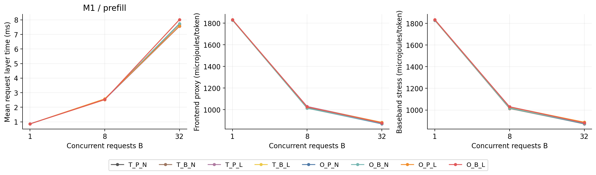

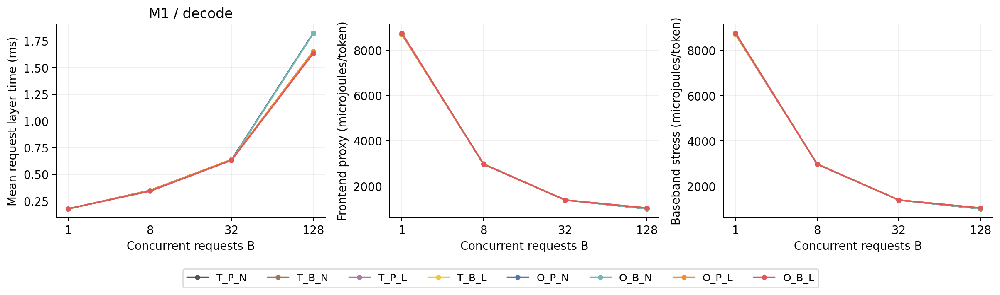

### M2：绝对延迟与能耗

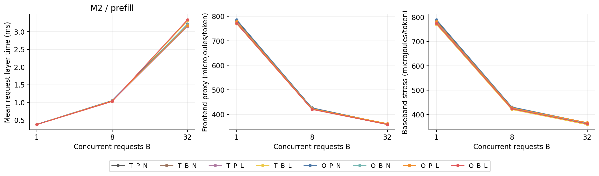

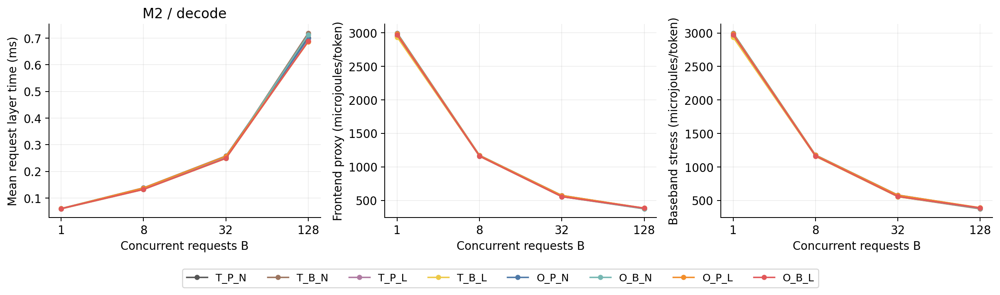

### M3：绝对延迟与能耗

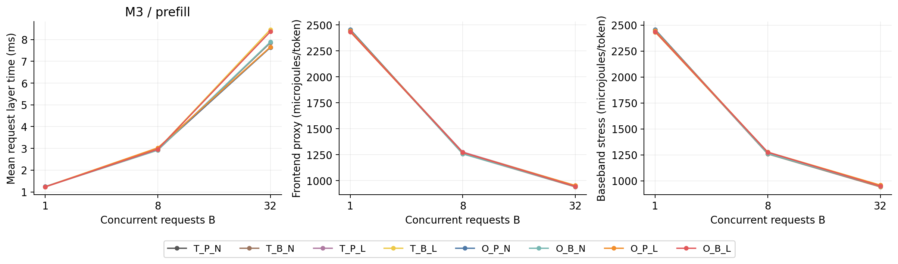

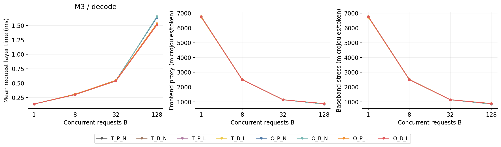

### B32请求层延迟分布

下列均值、p50和p95单位为毫秒；分别先在每个种子的128个请求上计算，再取五种子平均。Prefill为整个prompt完成延迟，Decode为每个请求实际步数的平均单层延迟。token分布和每轮活跃B另存原始Parquet与运行表。

| 模型 | 负载 | 策略 | 均值 ms | p50 ms | p95 ms |
|---|---|---|---|---|---|
| M1 | prefill | T_P_N | 7.574 | 7.5478 | 11.751 |
| M1 | prefill | T_B_N | 7.7085 | 7.8321 | 11.87 |
| M1 | prefill | T_P_L | 7.5513 | 7.5715 | 12.084 |
| M1 | prefill | T_B_L | 8.0193 | 8.1812 | 12.096 |
| M1 | prefill | O_P_N | 7.5788 | 7.7266 | 11.798 |
| M1 | prefill | O_B_N | 7.748 | 7.8432 | 11.868 |
| M1 | prefill | O_P_L | 7.5796 | 7.4752 | 11.941 |
| M1 | prefill | O_B_L | 8.0068 | 8.1314 | 12.082 |
| M1 | decode | T_P_N | 0.63747 | 0.6673 | 0.71166 |
| M1 | decode | T_B_N | 0.63579 | 0.66809 | 0.71116 |
| M1 | decode | T_P_L | 0.63799 | 0.66793 | 0.71235 |
| M1 | decode | T_B_L | 0.6363 | 0.66871 | 0.71176 |
| M1 | decode | O_P_N | 0.63779 | 0.66572 | 0.70758 |
| M1 | decode | O_B_N | 0.63171 | 0.6642 | 0.70948 |
| M1 | decode | O_P_L | 0.6383 | 0.66624 | 0.70828 |
| M1 | decode | O_B_L | 0.63222 | 0.66473 | 0.71 |
| M2 | prefill | T_P_N | 3.2134 | 3.1628 | 4.9156 |
| M2 | prefill | T_B_N | 3.2043 | 3.1754 | 4.943 |
| M2 | prefill | T_P_L | 3.1562 | 3.141 | 4.9541 |
| M2 | prefill | T_B_L | 3.3113 | 3.3718 | 4.9066 |
| M2 | prefill | O_P_N | 3.2178 | 3.168 | 4.9851 |
| M2 | prefill | O_B_N | 3.1999 | 3.1634 | 4.8894 |
| M2 | prefill | O_P_L | 3.1704 | 3.1739 | 5.0088 |
| M2 | prefill | O_B_L | 3.3416 | 3.3737 | 4.9256 |
| M2 | decode | T_P_N | 0.25388 | 0.26714 | 0.31439 |
| M2 | decode | T_B_N | 0.24925 | 0.26767 | 0.30265 |
| M2 | decode | T_P_L | 0.25318 | 0.26645 | 0.31387 |
| M2 | decode | T_B_L | 0.24854 | 0.26697 | 0.30215 |
| M2 | decode | O_P_N | 0.25783 | 0.26728 | 0.31199 |
| M2 | decode | O_B_N | 0.24985 | 0.26839 | 0.30128 |
| M2 | decode | O_P_L | 0.25711 | 0.26645 | 0.3113 |
| M2 | decode | O_B_L | 0.24914 | 0.26761 | 0.30078 |
| M3 | prefill | T_P_N | 7.6385 | 7.4805 | 12.376 |
| M3 | prefill | T_B_N | 7.8517 | 7.7687 | 12.279 |
| M3 | prefill | T_P_L | 7.6525 | 7.3547 | 12.697 |
| M3 | prefill | T_B_L | 8.4621 | 8.5681 | 12.576 |
| M3 | prefill | O_P_N | 7.6379 | 7.5788 | 12.421 |
| M3 | prefill | O_B_N | 7.8879 | 7.7786 | 12.447 |
| M3 | prefill | O_P_L | 7.6564 | 7.5063 | 12.775 |
| M3 | prefill | O_B_L | 8.3635 | 8.4102 | 12.653 |
| M3 | decode | T_P_N | 0.54698 | 0.56901 | 0.609 |
| M3 | decode | T_B_N | 0.53697 | 0.56737 | 0.61913 |
| M3 | decode | T_P_L | 0.54651 | 0.56864 | 0.60855 |
| M3 | decode | T_B_L | 0.53651 | 0.56693 | 0.61879 |
| M3 | decode | O_P_N | 0.54869 | 0.56649 | 0.60501 |
| M3 | decode | O_B_N | 0.5379 | 0.56764 | 0.61754 |
| M3 | decode | O_P_L | 0.54822 | 0.56602 | 0.60469 |
| M3 | decode | O_B_L | 0.53744 | 0.56729 | 0.6173 |

## 6. 结果整理与对照

重点表采用B32。完整B=1/8/32及Decode B128结果见aggregate.csv、raw_runs.csv与对应图表。跨模型仅讨论各自相对基线的变化，不把不同矩阵规模导致的原始延迟差异归因于通信机制。

| 模型 | 负载 | O_B_L加速比 [95%区间] | 前端节能 | 压力节能 |
|---|---|---|---|---|
| M1 | decode | 1.0083 [1.0067, 1.0102] | 0.348% | 0.142% |
| M1 | prefill | 0.9459 [0.9308, 0.9616] | -0.702% | -0.965% |
| M2 | decode | 1.0190 [1.0174, 1.0208] | 2.521% | 1.991% |
| M2 | prefill | 0.9617 [0.9492, 0.9746] | 0.623% | -0.199% |
| M3 | decode | 1.0178 [1.0159, 1.0197] | -0.211% | -0.490% |
| M3 | prefill | 0.9133 [0.8921, 0.9351] | 0.226% | -0.072% |

通信字节减少与请求延迟变化分别如下；节省为正、增加为负。空口字节按物理发射一次计，不把广播接收方数乘回发射字节。专家批量变化会改变权重复用和eDRAM流量；以下T→O指T_P_N→O_B_L整组对比。

| 模型 | 负载 | Dispatch节省 | Return节省 | 平均专家批量 T→O | eDRAM读写 MB/token T→O | 请求延迟变化 |
|---|---|---|---|---|---|---|
| M1 | decode | 71.78% | 4.91% | 2.509 → 2.515 | 41.490 → 41.463 | -0.824% |
| M1 | prefill | 71.82% | 4.75% | 4.551 → 3.942 | 23.827 → 27.251 | +5.714% |
| M2 | decode | 83.47% | 17.51% | 1.859 → 1.916 | 21.551 → 20.993 | -1.868% |
| M2 | prefill | 83.47% | 17.46% | 4.002 → 3.713 | 10.770 → 11.537 | +3.988% |
| M3 | decode | 82.02% | 14.70% | 2.446 → 2.446 | 40.366 → 40.433 | -1.744% |
| M3 | prefill | 82.03% | 14.71% | 4.110 → 3.810 | 24.959 → 26.833 | +9.492% |

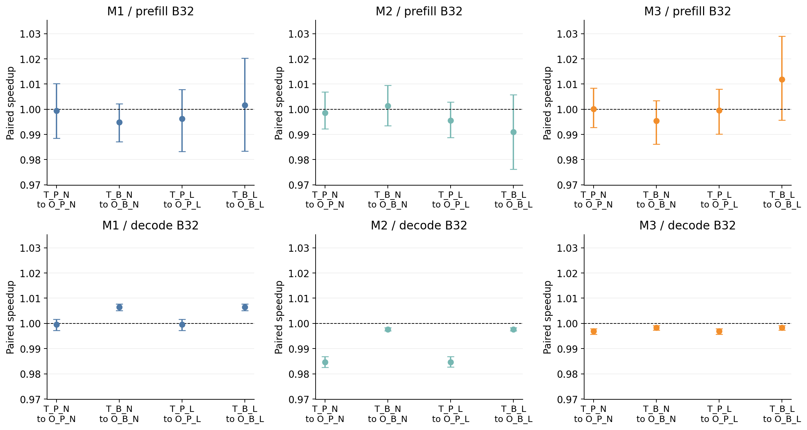

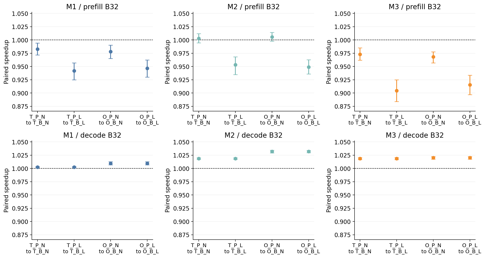

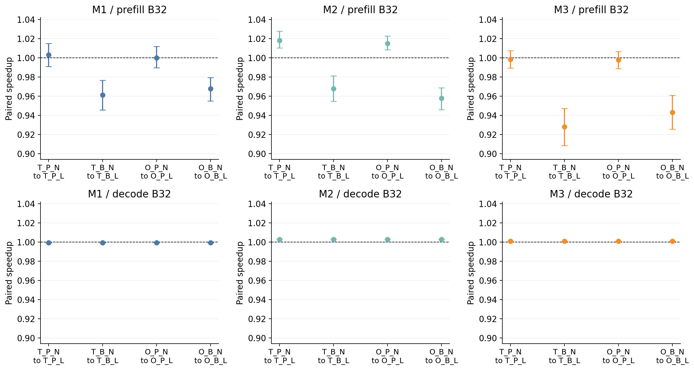

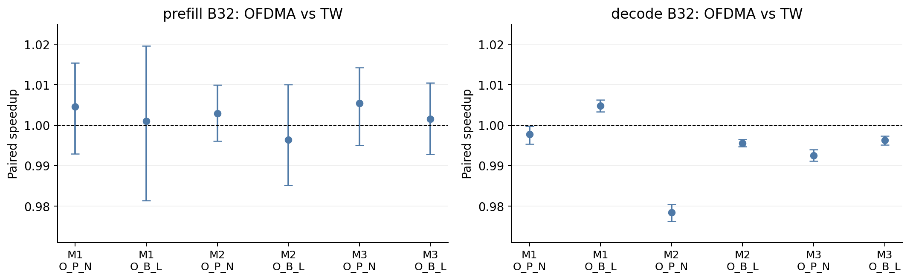

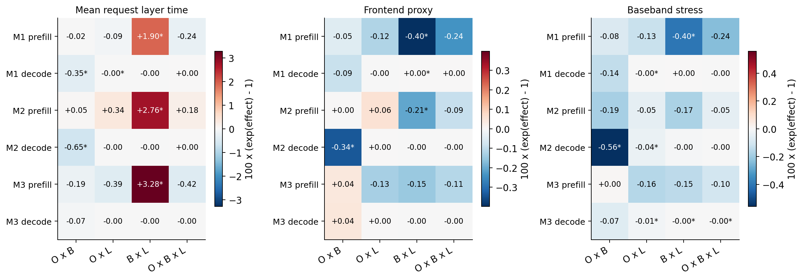

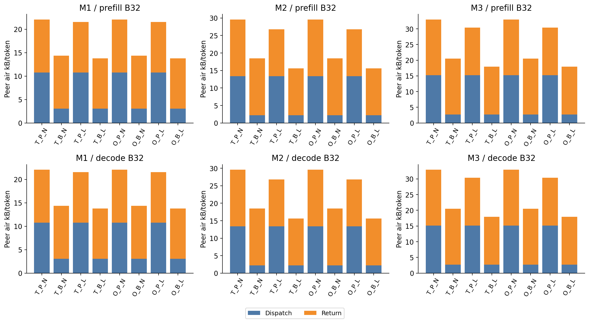

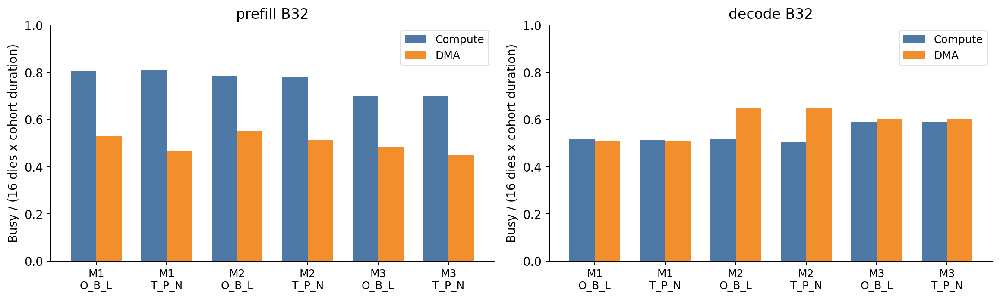

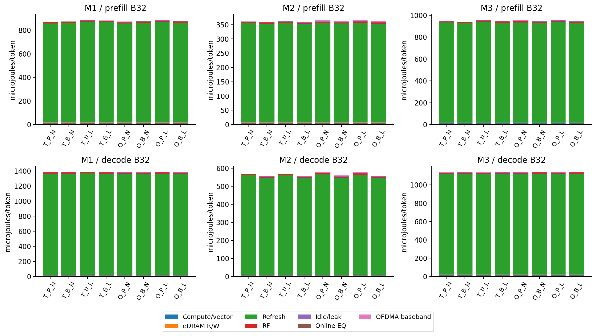

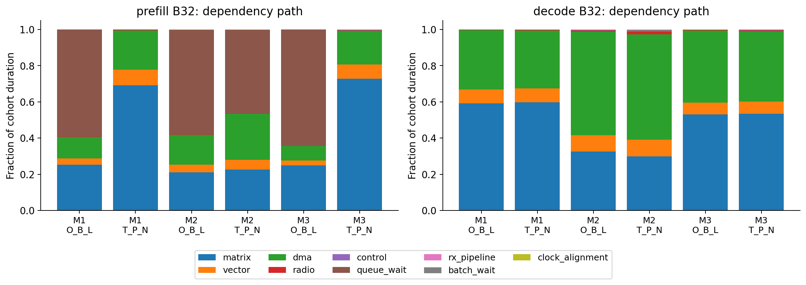

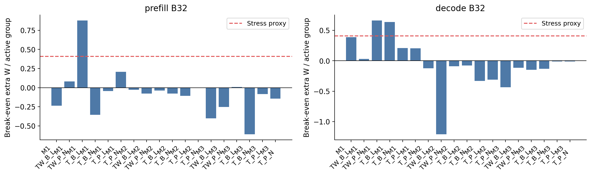

广播在同一输入发往多个Die时复用空口，单目的退化为单播。P2P基线也按目的Die去重。Local Combine只合并同token同Die的贡献，是否减少返回取决于实际命中重合；两个shared贡献的owner/buddy重合也已计入。

均匀无放回路由中，令p=1−C(E−E/16,k)/C(E,k)。无shared模型的远端目的Die数期望为15p；M3的buddy必达，故为1+14p。下表与冻结trace实际命中数对照，排除owner本地贡献；不把Top-k直接当作通信份数。

| 模型 | 负载 | 均匀理论远端Die数 | 实际远端Die数 | 实际token数 |
|---|---|---|---|---|
| M1 | decode | 3.5685 | 3.5692 | 39808 |
| M1 | prefill | 3.5685 | 3.5737 | 14973 |
| M2 | decode | 6.1842 | 6.192 | 39876 |
| M2 | prefill | 6.1842 | 6.1908 | 15338 |
| M3 | decode | 5.6516 | 5.6506 | 39936 |
| M3 | prefill | 5.6516 | 5.6562 | 16049 |

OFDMA保持同一满带宽锚点，另付14/17效率损失。与TW对照用于判断收益是否依赖帧空尾；不能把“可并发发送”直接等同于更低完整层延迟。factorial_interactions.csv给出对数尺度二阶和三阶交互，三项百分比不可直接相加。

交互采用标准2³因子效应：T/P/N编码−1，O/B/L编码+1；对因素集合S计算effect=Σ[∏(x_i, i∈S)×log(metric)]/4。乘性形式为exp(effect)，对应回归交互系数的两倍。factorial_summary.csv提供全部八组合共同配对、按种子/cohort重抽的95%区间。能量对比的公共token分母在该零和对比中消去。

### 敏感性与不确定性

15个单因素轴的三个指标均已出图：速率降额、广播速率、计算利用率、内存带宽与能耗修正、刷新周期、计算能耗、OFDMA和EQ功耗、帧长、广播监听范围、路由热点、Decode复用、待机及向量能耗倍率。所有曲线均含默认点，且默认点来自主实验。

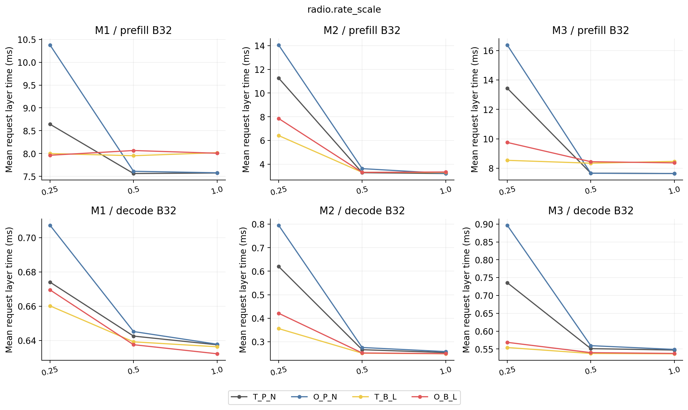

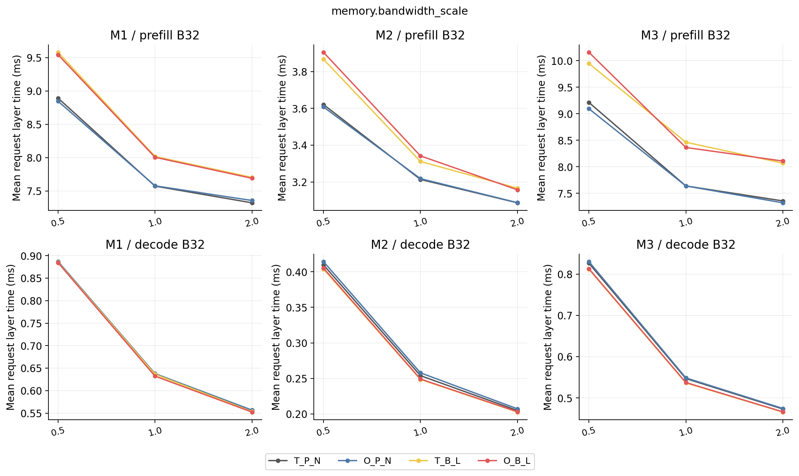

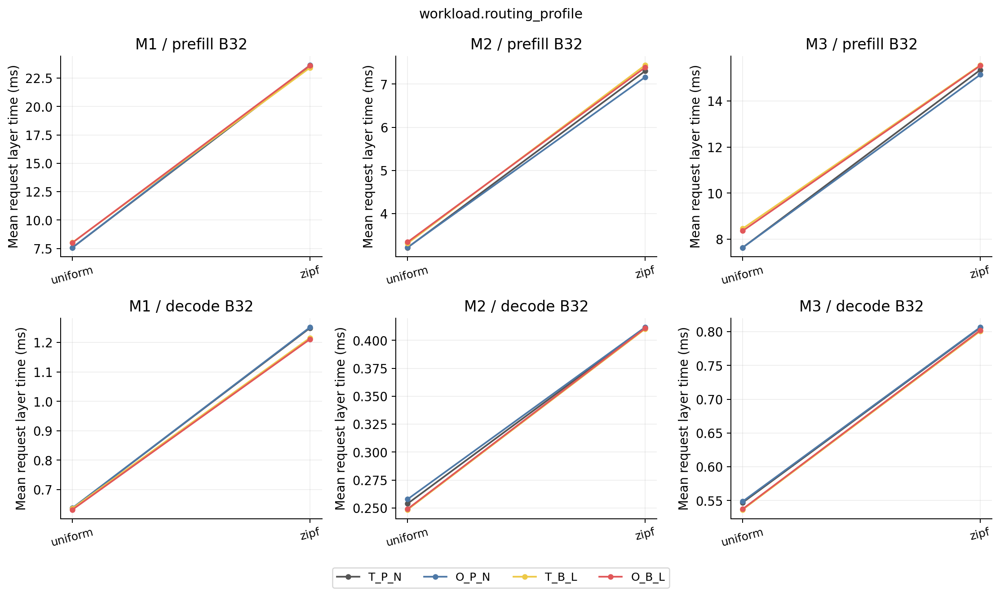

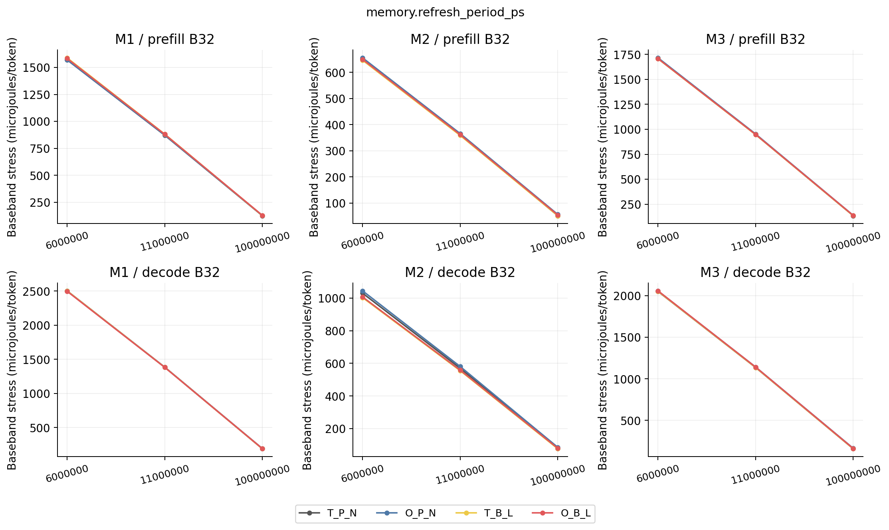

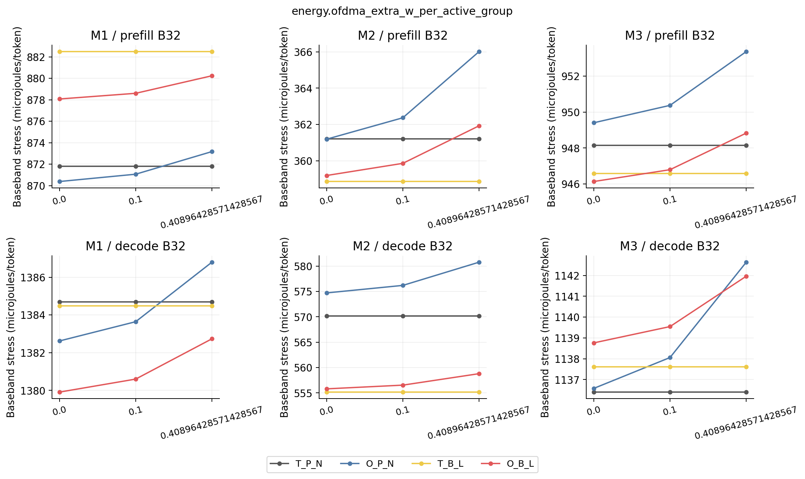

## 7. 结论

M1 decode B32：O_B_L相对T_P_N的加速比为1.0083，95%区间[1.0067, 1.0102]；前端proxy节能率0.348%（95%区间[0.176%, 0.519%]），基带压力账本节能率0.142%（95%区间[-0.031%, 0.314%]）。

M1 prefill B32：O_B_L相对T_P_N的加速比为0.9459，95%区间[0.9308, 0.9616]；前端proxy节能率-0.702%（95%区间[-1.161%, -0.197%]），基带压力账本节能率-0.965%（95%区间[-1.415%, -0.468%]）。

M2 decode B32：O_B_L相对T_P_N的加速比为1.0190，95%区间[1.0174, 1.0208]；前端proxy节能率2.521%（95%区间[2.177%, 2.843%]），基带压力账本节能率1.991%（95%区间[1.649%, 2.317%]）。

M2 prefill B32：O_B_L相对T_P_N的加速比为0.9617，95%区间[0.9492, 0.9746]；前端proxy节能率0.623%（95%区间[0.010%, 1.161%]），基带压力账本节能率-0.199%（95%区间[-0.844%, 0.356%]）。

M3 decode B32：O_B_L相对T_P_N的加速比为1.0178，95%区间[1.0159, 1.0197]；前端proxy节能率-0.211%（95%区间[-0.500%, 0.132%]），基带压力账本节能率-0.490%（95%区间[-0.780%, -0.149%]）。

M3 prefill B32：O_B_L相对T_P_N的加速比为0.9133，95%区间[0.8921, 0.9351]；前端proxy节能率0.226%（95%区间[-0.501%, 0.999%]），基带压力账本节能率-0.072%（95%区间[-0.805%, 0.715%]）。

加速比区间包含1时，尚未显示稳定的延迟优势；节能率区间包含0时，尚未显示稳定的能量优势。组合变化不能全部归功于OFDMA，须结合第6节固定其它机制的条件比较。

M1 decode B32：O_P_N相对强基线TW_P_N加速比0.9977，区间完全低于1。该比较保留实际控制成本并去除了固定帧空尾。

M1 decode B32：O_B_L相对强基线TW_B_L加速比1.0048，区间完全高于1。该比较保留实际控制成本并去除了固定帧空尾。

M1 prefill B32：O_P_N相对强基线TW_P_N加速比1.0046，区间包含1。该比较保留实际控制成本并去除了固定帧空尾。

M1 prefill B32：O_B_L相对强基线TW_B_L加速比1.0010，区间包含1。该比较保留实际控制成本并去除了固定帧空尾。

M2 decode B32：O_P_N相对强基线TW_P_N加速比0.9784，区间完全低于1。该比较保留实际控制成本并去除了固定帧空尾。

M2 decode B32：O_B_L相对强基线TW_B_L加速比0.9955，区间完全低于1。该比较保留实际控制成本并去除了固定帧空尾。

M2 prefill B32：O_P_N相对强基线TW_P_N加速比1.0029，区间包含1。该比较保留实际控制成本并去除了固定帧空尾。

M2 prefill B32：O_B_L相对强基线TW_B_L加速比0.9964，区间包含1。该比较保留实际控制成本并去除了固定帧空尾。

M3 decode B32：O_P_N相对强基线TW_P_N加速比0.9925，区间完全低于1。该比较保留实际控制成本并去除了固定帧空尾。

M3 decode B32：O_B_L相对强基线TW_B_L加速比0.9963，区间完全低于1。该比较保留实际控制成本并去除了固定帧空尾。

M3 prefill B32：O_P_N相对强基线TW_P_N加速比1.0054，区间包含1。该比较保留实际控制成本并去除了固定帧空尾。

M3 prefill B32：O_B_L相对强基线TW_B_L加速比1.0015，区间包含1。该比较保留实际控制成本并去除了固定帧空尾。

所有结果是单层、热态、真实文本长度与合成路由下的架构模型估计。16节点覆盖、两介质隔离、在线均衡/OFDMA基带、64MB eDRAM外围及跨精度计算能耗仍含未实测外推；置信区间描述路由种子和请求变化，不覆盖硬件模型不确定性。

当前未满足的验收项为FP8小算例NRMSE≤5%。本文保留失败结果和原门槛；可用于检查时序/资源/能耗模型和比较机制，但不能作为满足数值精度要求或真实目标芯片PPA的证据。

### 附录：复现与文件索引

安装：bash scripts/setup_env.sh。完整复现：python -m vdie_moe_sim.run_all --spec VDIE_MOE_SIM_SPEC.md --output results。已有同版本结果使用--resume；--require-numeric-gate可要求在该数值验收失败时先停止时序实验。

token_metrics.parquet是按时序配置分片的Parquet数据集，避免复制能量情景的同一token时间表；raw_runs.csv中的temporal_run_id连接重算/等价记录。runs/<id>/ledger.parquet保留事件计数，record.json保存输入/引擎/文件哈希。

| 文件 | 内容 |
|---|---|
| manifest.json / validation.json | 完整计划、来源与依赖、完成状态、通过/失败检查 |
| parameters.csv / config_resolved.yaml | 参数含义与实际主配置；每条overrides在manifest中 |
| traces/*.jsonl.gz / input_manifest.json | 冻结路由和真实分词长度、revision、文件哈希 |
| raw_runs.csv / aggregate.csv | 全部记录及五种子汇总 |
| token_metrics.parquet / cohort_metrics.parquet | token细节及配对cohort单位 |
| paired_effects.csv / factorial_interactions.csv / factorial_summary.csv | 三机制配对效应与交互项；含共同配对95%区间 |
| resource_and_dependency_metrics.csv | 计算/DMA资源busy-time、利用率与依赖路径分解 |
| scheduler_metrics.csv | 有效帧长、控制窗口/利用率、包粒度grant平均服务时长 |
| energy_breakdown.csv / ofdma_power_threshold.csv | 能耗分项与新增基带功耗盈亏阈值 |
| figures/*.png / *.svg / *.csv | 可导出图表及每图源数据 |

论文数据与条件采用上传规范中的来源标注；官方模型配置、数据集和tokenizer均冻结版本。P1的264Gb/s为双通道合计；P2为FP16 SRAM-CIM原型；P7为小宏仿真；P8为DMT接收器压力参照，均不伪装为目标16-Die芯片实测。

| 引用 | URL |
|---|---|
| P1 | https://doi.org/10.1109/JSSC.2026.3720291 |
| P2 | https://doi.org/10.1109/JSSC.2024.3402808 |
| P3 | https://arxiv.org/abs/2508.10925 |
| P4 | https://arxiv.org/abs/2505.09388 |
| P5 | https://ernie.baidu.com/blog/publication/ERNIE_Technical_Report.pdf |
| P6 | https://arxiv.org/abs/2412.19437 |
| P7 | https://doi.org/10.3390/jlpea14010002 |
| P8 | https://doi.org/10.1109/JSSC.2025.3618188 |
| P9 | https://arxiv.org/abs/2504.05897 |
| P10 | https://arxiv.org/abs/2502.09007 |
| C1 | https://huggingface.co/openai/gpt-oss-20b/blob/main/config.json |
| C2 | https://huggingface.co/Qwen/Qwen3-30B-A3B/blob/main/config.json |
| C3 | https://huggingface.co/baidu/ERNIE-4.5-21B-A3B-PT/blob/main/config.json |
| C4 | https://github.com/openai/gpt-oss/blob/main/gpt_oss/torch/model.py |
| C5 | https://github.com/huggingface/transformers/blob/v4.55.4/src/transformers/models/ernie4_5_moe/modeling_ernie4_5_moe.py |
| D1 | https://huggingface.co/datasets/MohamedRashad/ChatGPT-prompts |
